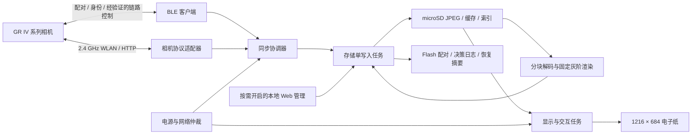
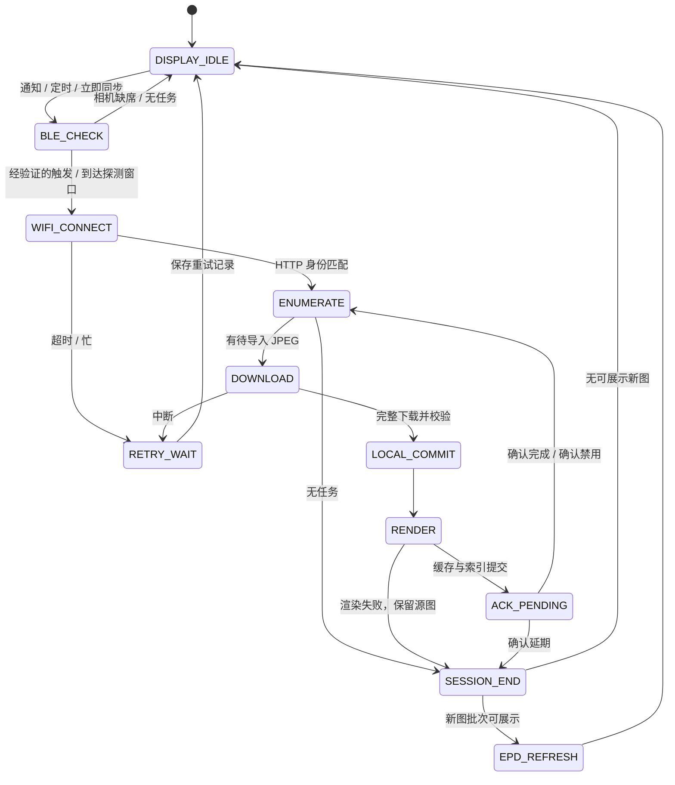

# GR IV 系列墨水屏黑白相框：技术方案与实现设计

版本：v1.0  
日期：2026-09-30（北京时间）  
需求基线：墨水屏黑白相框 PRD v2.0，2026-09-29  
目标硬件：MindReset Read Pico / ESP32-S3  
相机范围：RICOH GR IV、GR IV HDF、GR IV Monochrome  
文档性质：可实施设计与验证计划；不是实机测试报告。

展示决策更新（2026-10-01）：按用户最新要求，照片默认采用 `cover-center-v1`，以同一缩放比例铺满 1216×684、居中裁掉溢出部分，不拉伸。下文旧 Fit／完整构图默认作为历史方案保留。可移植核心新增 Cover 与显式源 ROI，Demo 0 使用 Cover；主机 `frame_convert --cover` 可生成独立内部 g4。旧持久化 layout=1 仍为 Fit，暂不把 Cover 接入该导入／恢复契约；接入产品库前必须增加新 layout 标识及缓存失效／重渲染验证。三图诊断不使用 PFG1 旧缓存，私人白框 ROI 只属于本次样片预处理，不自动用于相机照片。异常竖条仍独立待排查。

## 1. 技术结论与决策

2026-10-03 USB适配更新：固定SDK无驱动VFS的O_NONBLOCK路径不读取硬件FIFO；独立io/gr4_usb_rx.c改用O_RDONLY预读取分支，每轮≤32次单字节、检查未安装驱动并在stop/断开时丢弃局部批次。专用配置禁止并发输入消费者、driver_install/use_driver或修改全局VFS读取模式；不泛化到其他SDK，也不称内部锁硬实时。便携核心/token/5秒截止不变。49项主机包含实际SDK函数回归、专用编译/门禁通过；真实USB/相机仍另验，最新以 [身份诊断](GR4-IDENTITY-DIAGNOSTIC.md) 与TODO为准，后文48组为历史。

2026-10-03当前：新增专用 `FRAME_GR4_IDENTITY_DIAGNOSTIC`，同SDK被动扫描→静态提示队列→USB严格命令/现场新动作→host核对当次token和期限→一次只读Owner→输入退出/SDK及板卡清理。普通compile-only模式仍禁止烧写；默认不启用BLE。48组主机/37项门禁及专用真实SDK编译通过，本版未烧写/未连接相机，型号/版本认证未放行。可信本机TTY人工工具只是受控测试输入，不是USB密码认证；RNG nonce只作重放区分，前无线阶段不保证真随机。详见 [只读身份诊断](GR4-IDENTITY-DIAGNOSTIC.md)。以下44组及缺输入/入口描述为历史。

2026-10-03最新：固定静态确认消息通道接入同SDK host扫描会话，输入任务仅投递不可变消息，host核对启动nonce/当次epoch/id/services、期限后一次消费；关闭不删除队列、迟到输入不引用NPL/SDK。44组ASan/UBSan、33项门禁、真实SDK隔离ELF/正式默认/无连接编译通过，基线摘要未变/未烧。实际输入驱动/界面、新动作/nonce、生产者有界退出和连接设备入口尚未实现，仍compile-only，设备保持792c5409…。详见 [确认消息通道](GR4-CONFIRMATION.md)；以下43组等为历史。

2026-10-02最新：同一次SDK生命周期host扫描/禁收/取消/inactive→新鲜确认API→一次延迟Owner激活完成，85秒主任务外部期限、关闭/复位栅栏及扫描timer退出屏障；43组ASan/UBSan、33项门禁与实际SDK隔离ELF/默认/无连接编译通过。现场人工确认通道/连接设备入口未启用、仍compile-only；只读取三项公开身份并停在未认证，不启用配对/通知/状态写入。设备仍792c5409…无连接版，重编dac733a0…未烧，本轮无设备/相机操作。见 [同SDK会话](GR4-SCAN-SESSION.md)；以下41组及更早为历史。

2026-10-02当前：SDK独立期限/timer guard/分阶段清理及无连接诊断首次真机生命周期PASS（17条一致结果，启动头/前3条缺失）；受控候选选择与无IO Owner交接新增，41组ASan/UBSan、门禁32项、真实SDK隔离ELF/默认/无连接编译通过。连接设备入口仍未启用，需要同一SDK生命周期扫描停止证据、当次确认和延迟激活，不能在旧扫描销毁SDK后复用地址。唯一服务候选/人工确认只许可未认证只读尝试，不放行配对或状态写入；设备仍792c5409…、重编09101d54…未烧。见 [候选选择](GR4-TARGET-SELECTION.md) 与 [SDK退出](GR4-RADIO-LIFETIME.md)；下方36组等为此前阶段历史。

2026-10-02最新：受控Owner的应用timer改用独立ESP timer，仅投递host event；host退出后正常外部任务先有界stop_blocking屏障，再检查delete/事件移除/释放，失败封存保留，Owner/tickets不复用。主机36组及真实SDK组件/默认编译通过。SDK内部callout/队列/transport静默、独立watchdog、整机SDK/controller与板卡退出、设备入口仍未完成，compile-only禁止烧写，不计cleanup=1或真实并发，无本轮设备/相机操作，见 [应用定时器退出边界](GR4-HOST-TIMER.md)。以下为此前阶段记录。

2026-10-02最新操作层：有界会话/真实NimBLE发现与三项身份长读取实现，34组ASan/UBSan、门禁27项及真实SDK组件编译通过；无SMP/cache、无连接/退出Owner或设备入口。操作超时仅停止会话，不证明无线清理，必须由同host串行执行的Owner关闭链接并验证host结束；ticket不可复用/提前释放。身份未验证终态不放行Power/Operation。compile-only产物门禁拒绝烧写，当前设备不变，见 [GATT操作层](GR4-GATT-IO.md)。以下核心阶段及更早记录为历史。

2026-10-02最新实现：便携GATT五字段动态句柄/服务归属/读取属性计划及严格文本、Power/Operation Mode参考解析完成，33组ASan/UBSan及默认组件编译/门禁通过。核心不负责无线IO、连接世代检测或身份认证，参考值映射尚未在本机验证；独立适配须完整发现、先核实型号版本、隔离旧回调并有界停止。设备仍bd74b761…扫描版，本轮未烧写或连接相机，见 [GATT核心](GR4-GATT-CORE.md)。以下参考核对及更早实施记录为历史。

2026-10-02条件修正与参考核对：第二次同版扫描30秒截止/清理通过，用户仅关机而非关闭无线，仍1个Bluetooth Control协议候选，不计无广播对照。官方确认GR IV无线开启时关机仍广播。用户Live-View代码只读核对显示其在连接/协议识别后读取Power/Operation Mode，不能用广播服务位判断开关机。产品设计分离候选存在/型号版本/电源/工作模式/认证；参考固定句柄、配对参数、手动唤醒及取景器Wi-Fi门禁不直接移植，Unknown不授权状态写入。本轮无固件修改或相机连接，详见 `GR4-BLE-REFERENCE-NOTES.md`；后续独立只读GATT诊断与真实无线关闭对照另行实施。

2026-10-02修正版真机进展：bd74b761…首次人工启动扫描流程PASS，候选1、30秒主动截止/inactive1/code0/cleanup1及全部20次一致完整聚合结果，应用返回。APP_ENTRY/STARTED/启动头缺失，不证明独立掉电/射频功耗或相机型号身份；相机关闭蓝牙对照/重复会话和Gate A配对仍未验。仅采证/文档，未启用连接/配对或修改SDK/BSP，详见 `GR4-PASSIVE-SCAN.md`。以下待启动为历史。

2026-10-02截止修复：旧Observer-only扫描收到候选但code9/cleanup1，定位固定SDK未执行GAP结束定时条件后，仅在本项目适配层加入30秒tick截止/显式取消/inactive确认，提前结束或清理失败拒绝成功。32组主机/28场景及默认/专用编译通过，已完整备份/直接烧写bd74b761…及扩展回读一致，设备留下载器，修正版真机待人工启动。仍不连接/配对/修改SDK或BSP，详见 `GR4-PASSIVE-SCAN.md`；下段为旧版阶段历史。

2026-10-02后续进展：独立有界被动扫描已实现并经32组主机测试/专用门禁/编译，备份与扩展回读后烧写，待人工启动。仅Observer接收广播，不连接/配对/GATT或刷新图片，候选UUID不证明型号；SDK停止失败保留资源并明确未清理，不保证异常时无线已停。详见 `GR4-PASSIVE-SCAN.md`。下段“无无线适配/不烧写”为上一便携模块阶段记录，Gate A未通过。

2026-10-02最新状态：JPEG生成缓存SD三图本轮用户回复“没有问题”，比例/铺满/竖条/残影验收通过，首图单张日志缺失仍保留。新增便携广播候选解析/有界会话表，31组主机测试与默认v6.1组件编译通过；无无线适配或运行时调用，本轮不烧写。UUID只识别协议候选，不证明GR IV型号或Gate A；独立被动扫描、型号/版本/配对另行验证，见 `GR4-ADVERTISING.md`。以下实屏待验语句为反馈前历史。

2026-10-02实现补充：指定三图设备SD JPEG解码/Cover生成/缓存与固定索引提交、后续已有源/缓存/索引严格只读人工启动恢复已分别真机PASS。新生成缓存只读SD显示独立诊断已实现/测试/编译/烧写及扩展回读，实屏待验；旧cache-ram-test视觉通过不作新库证据。此固定诊断不等于正式产品库或GR IV链路。读取使用完整暂存校验与库元数据复核后再发布，缺失/损坏不重建，不解码或用嵌入像素兜底，见 `JPEG-CACHE-DISPLAY.md`。

Cover 缓存进展补充（2026-10-01）：上述“暂不接入导入／恢复契约”已推进为 layout=2、主机显式导入／按源凭据恢复及完整缓存只读加载接口；旧 Fit layout=1 仍保留。已提交缓存自动迁移和设备 SD 读图→GC16 尚未完成，不能沿用嵌入三图验收证明。详见 `COVER-CACHE.md`。

推荐以 **BLE 建立身份关系和低功耗控制，2.4 GHz Wi-Fi 承载 HTTP 照片同步，microSD 保存照片，预生成 4 bpp 展示缓存，GC16 显示照片** 为主架构。日常链路由相框自主完成，无手机转发、无账号、无云服务，也不需要修改相机固件。

当前证据已经足以把 PRD 中的“传输协议 TBD”推进为“HTTP 优先实现”。用户提供的 GR IV 1.11 静态分析发现了 `/v1/transfers`、照片下载和传输状态写入接口，BLE 分析发现了身份、WLAN 与传输相关特征。但接口存在不代表第三方客户端已能完成预约自动闭环；预约语义、BLE 启动 Wi-Fi 的负载和关机恢复仍是发布前置条件。[L2][L3]

| 决策 | 实现选择 | 约束 |
| --- | --- | --- |
| 相机接入 | 相框为 BLE Central/GATT Client；相机为外设 | 先验证数字比较配对与绑定恢复 |
| 网络拓扑 | 相机 AP，相框 STA 的直连方式优先验证 | BLE NetworkType 枚举与相机网络角色必须实测；不预设相机可加入家中路由器 |
| 传输协议 | HTTP 80 + 可选 WebSocket `/v1/changes` | 私有接口适配器，不称为官方公开 SDK |
| 数据源 | 精准预约队列优先，明确降级的增量模式次之 | 不能将 `untransferred` 直接等同于“预约” |
| 输入 | 相机生成的 JPEG，优先 `size=xs` | RAW-only 不导入；不改变相机拍摄尺寸 |
| 存储 | microSD 保存 JPEG/渲染结果；Flash 保存身份、决策与恢复摘要 | 无 SD 不开启正式自动同步 |
| 图像处理 | 分块 RGB → 灰度 → Fit → 固定 LUT → 16 灰阶 | 不分配整张 XS RGB888 图 |
| 显示 | 照片使用 GC16；菜单局刷经样片验证后启用 | 多张到达合并刷新；不做照片淡出动画 |
| 低功耗 | 即时模式用连接保持与自动省电；省电模式周期唤醒 | 深睡不能实时接收 BLE 通知 |
| 相机写入边界 | 仅经验证的链路控制、配对及可选传输确认 | 原片永不删除，不修改曝光、图像风格、时间或相机固件 |

PRD 的“相机只读”应解释为**原片内容与删除操作只读**。BLE 配对、启动传输链路和回写“已传输”本身会改变相机状态。若要求所有相机状态也严格只读，则只能由用户手动开启 WLAN、读取接口并采用本地去重，不能同时承诺自动唤醒和相机端预约消除。这一边界在实现与测试中单独标记。[L1 §9、§26][L3 §5.4]

## 2. 依据与置信度

### 2.1 证据等级

本文使用四种标记：

- **官方确认**：厂家规格、FAQ、官方仓库直接说明的产品行为。
- **静态确认**：用户提供的固件分析证实路由、UUID、注册属性等；本文未重新逆向全部二进制。
- **设计决策**：本项目拟实现的软件结构、默认值、预算和提交顺序。
- **待实测**：负载编码、运行状态前提、事件语义、设备兼容性与实际性能。

官方资料确认预约、自动预约、XS 自动缩图及 BLE/Wi-Fi 分工；官方 App 可完成这些操作，并不证明 ESP32 第三方实现已经可用。[GR IV 官方 FAQ](https://www.ricoh-imaging.co.jp/english/support/qa/gr-4/index.html)

### 2.2 机型与固件支持矩阵

| 型号 | 本次证据 | 研发处理 | 可发布条件 |
| --- | --- | --- | --- |
| GR IV | 用户提供的 1.11 包，内部标识 `1.11.10.7` | 首台验证基线，优先完成全链路 | 对该机型/实际版本完成 Gate A–F |
| GR IV HDF | 官方规格/FAQ；本次未提供独立固件分析 | 复用架构，独立发现服务、路由和队列语义 | 独立兼容测试通过，不能仅凭 GR IV 测试放行 |
| GR IV Monochrome | 官方 FAQ；本次未提供独立固件分析 | 独立能力档案；保留相机 JPEG 黑白表现 | 独立兼容测试通过 |
| 其他 GR | 不在本次范围 | 不建立协议适配和宣传支持 | 后续单独项目 |

系列型号存在可由[GR IV/HDF 官方规格](https://www.ricoh-imaging.co.jp/english/products/gr-4/spec/)、[HDF FAQ](https://www.ricoh-imaging.co.jp/english/support/qa/gr-4hdf/)及[Monochrome FAQ](https://www.ricoh-imaging.co.jp/english/support/qa/gr-4-mono/)核对。不得把 GR IV 镜像中的公共枚举、视频或滤镜代码视为每款机型全部具备的能力。

适配键采用 `(manufacturer, model, firmwareVersion, observed_schema_version)`。未知固件先进入诊断/只读取图模式，禁用未经验证的 BLE 写入和传输确认。固件升级后重新发现 GATT，不能沿用旧 attribute handle。

### 2.3 已知能力与验证缺口

| 能力 | 当前判断 | 必须补齐的证据 |
| --- | --- | --- |
| 相机信息 GATT | UUID、长度、读属性静态确认 | 实际字符串、绑定后权限 |
| Numeric Comparison | 固件存在确认回调 | ESP32 安全参数、双端确认流程 |
| WLAN SSID/口令读取 | 特征静态确认 | 何时可读、编码、尾部零字节处理 |
| BLE 控制 WLAN | 有 NetworkType/频段等可写特征 | 开关值、写入顺序、是否还需 OperationMode |
| 关机 BLE 广播 | 官方条件式支持 | 第三方重连及进入传输模式的步骤 |
| HTTP 照片列表/XS 下载 | 路由和参数静态确认 | 响应 JSON 层级、XS 实际字节与返回类型 |
| 预约识别 | `/v1/transfers` 为强候选 | 人工预约前后差分，未预约对照 |
| 已传输回写 | PUT transfer 路由静态确认 | 预约标志是否清除、GR WORLD 是否共用状态 |
| Range 下载续传 | 未有证据 | 206、Content-Range、资源一致性 |
| BLE 队列通知 | 相关特征存在 | 哪个值/通知确实代表预约变化 |
| 16 灰阶 EPD | 官方硬件/示例支持 | 峰值电流、温度、残影与照片样片 |

## 3. 硬件与开发基线

Read Pico 官方资料确认 ESP32-S3、8 MB PSRAM、16 MB Flash、4.7 英寸原生 16 灰阶、microSD、双点触控、三个触摸键与可更换 2050 mAh 电池；显示分辨率为 1216 × 684。[硬件文档](https://dot.mindreset.tech/docs/read_0)、[官方固件](https://github.com/MindReset/read_pico_firmware)

### 3.1 固件复用策略

推荐复用厂家 BSP、PMU 协议、触控/加速度计/IO 扩展驱动、EPD 波形与 SDMMC 支持，新增独立照片应用和同步组件。书籍功能不作为产品功能引入；现有浏览器上传只是可参考的网络服务结构，不能直接宣称已有完整 JPEG 相框管理。

本次查询的上游基线 commit：`28cde682a4468a581c278761922724f57d976418`。正式开工应锁定此 commit 或经重新验证的明确 commit，不追踪浮动 `main`。

当前上游要求 ESP-IDF 6.1，锁文件为 6.1.0；120 MHz Flash/PSRAM 时序依赖板载器件，CI 编译配置不等于真实板卡配置。保留厂家 PMU 中的 VCOM 校准值，不向用户开放调整。[构建说明](https://github.com/MindReset/read_pico_firmware/blob/28cde682a4468a581c278761922724f57d976418/README.md)、[依赖锁](https://github.com/MindReset/read_pico_firmware/blob/28cde682a4468a581c278761922724f57d976418/dependencies.lock)

### 3.2 软件选型

| 部分 | 推荐 | 实施说明 |
| --- | --- | --- |
| 运行时 | ESP-IDF + FreeRTOS，C/C++ | 与锁定 BSP 版本一致 |
| BLE | ESP-IDF NimBLE Host | 验证数字比较、bond 存储、RPA 解析与共存 |
| Wi-Fi | ESP-IDF STA | 首次设置推荐 2.4 GHz/WPA2-AES；WPA3/过渡模式单独测试 |
| HTTP | `esp_http_client` 流式读取 | 有界缓冲写 SD，不把 JPEG 全部放入 RAM |
| WebSocket | 兼容所选 IDF 的组件，锁定版本 | MVP 可先轮询替代；回调只发事件 |
| JPEG | TJpgDec 分块解码路径 | 优先复用上游 vendored 实现与许可证；调整输出目标 |
| JSON | cJSON 解析小页响应 | 明确响应上限；超限缩小分页，不解析 5000 项大列表 |
| SD | BSP + FatFS/SDMMC | 单写入者，介质移除立即取消任务 |
| 内部恢复存储 | NVS + 专用日志分区 | NVS 放小配置；防重复/用户决策采用有界可压缩日志 |
| EPD/UI | 厂家 EPDiy 分支 + 绘图原语 | 渲染和刷新只有一个拥有者 |

`esp_http_client` 支持流式读取；其阻塞操作必须置于工作任务。[HTTP 客户端文档](https://docs.espressif.com/projects/esp-idf/en/latest/esp32s3/api-reference/protocols/esp_http_client.html)

## 4. 系统架构与任务边界



| 模块 | 职责 | 禁止事项 |
| --- | --- | --- |
| `camera_gr4` | GATT 与 HTTP schema、能力档案、路径转换 | 不承担照片状态或 UI 决策 |
| `sync_manager` | 批次、分页、重试、确认、降级模式 | 不直接改文件索引 |
| `photo_store` | 文件/索引/日志事务、tombstone、容量管理 | 不调用相机接口 |
| `image_pipeline` | EXIF、颜色/灰度处理、渲染缓存 | 不在 EPD 回调或 BLE 回调解码 |
| `display_manager` | 当前照片、菜单、合并刷新 | 不发远程删除请求 |
| `power_manager` | 连接策略、唤醒、PMU、功耗记录 | 有未提交事务时不得断电 |
| `network_manager` | 相机 STA 与管理 AP/家庭 STA 互斥 | 不做桥接或相机 HTTP 代理 |
| `local_web` | P1 管理接口 | 不透传任意相机路径或命令 |

线程方案：网络/同步一个工作任务，存储一个写入任务，图像一个串行任务，显示/输入一个任务。BLE 和 WebSocket 回调仅复制有界事件并投递队列。队列满时合并为 `RESCAN_REQUIRED`，靠重新枚举修复，不依赖每条通知必达。

设置 `storage_generation`、`camera_session_generation`：拔 SD、切换相机、重连会话后递增；旧任务提交时必须比对，防止写入新卡或错误会话。P0 单相机、单文件下载、单图渲染，避免并发内存峰值。

## 5. 首次配置与 BLE 实现

### 5.1 引导流程

1. 启动 BSP，读取 PMU/VCOM，挂载并检查 microSD；无卡只开放设置/诊断。
2. 提示相机进入无线配对模式，扫描两类服务广播，列出候选相机。
3. GATT 发现，读 Manufacturer/Model/Serial/Firmware；用户选择目标。
4. 请求配对，在相框显示数字比较码，由用户在两端确认；保存 bond。
5. 保存相机稳定身份，读 WLAN 参数；若权限不允许，提供机身查看/相框手工输入兜底。
6. 提示用户在机身设置 2.4 GHz、Auto Resize；按用户选图模式决定是否开启自动预约。
7. 下载一张明确指定的测试 JPEG，再人工预约另一张，完成队列差分和测试显示。
8. 只有自动链路验证通过才将“自动同步可用”写入配置；否则显示具体已支持的同步模式。

默认推荐“手动选择预约”，避免首次连接导入全部历史图片。Automatic Image Transfer 表示拍摄后自动预约所有新图，并不等价于审美选图；作为可选设置由用户决定。[官方预约说明](https://www.ricoh-imaging.co.jp/english/support/qa/gr-4/index.html)

### 5.2 最小 GATT 集合

以下 UUID/长度来自用户的 BLE 固件分析。[L2 §5–7]

| 特征 | UUID | 权限/上限 | 本项目用途 |
| --- | --- | --- | --- |
| ModelName | `35FE6272-6AA5-44D9-88E1-F09427F51A71` | R / 11 B | 型号档案 |
| SerialNumber | `0D2FC4D5-5CB3-4CDE-B519-445E599957D8` | R / 8 B | 稳定身份 |
| FirmwareRevision | `B4EB8905-7411-40A6-A367-2834C2157EA7` | R / 10 B | 适配版本 |
| PairedDeviceName | `FE3A32F8-A189-42DE-A391-BC81AE4DAA76` | W / 33 B | 经验证后写简短可打印设备名 |
| NetworkType | `9111CDD0-9F01-45C4-A2D4-E09E8FB0424D` | R/W/N / 1 B | WLAN 状态/控制候选 |
| SSID | `90638E5A-E77D-409D-B550-78F7E1CA5AB4` | R/W / 33 B | 读取相机 WLAN 名 |
| Passphrase | `0F38279C-FE9E-461B-8596-81287E8C9A81` | R/W / 64 B | 读取密钥，不写日志 |
| WlanFrequency | `C4B7DFC0-80FD-4223-B132-B7D25A59CF85` | R/W / 1 B | 频段校验，枚举未知 |
| FileTransferList | `D9AE1C06-447D-4DEA-8B7D-FC8B19C2CDAE` | R/N / 2 B | 队列变化候选，不是完整文件列表 |
| CamSrvNotification | `FAA0AEAF-1654-4842-A139-F4E1C1E722AC` | R/N / 182 B | 状态变化候选 |
| CameraPower | `B58CE84C-0666-4DE9-BEC8-2D27B27B3211` | R/W/N / 1 B | 只读优先；唤醒写入须验证 |
| OperationMode | `1452335A-EC7F-4877-B8AB-0F72E18BB295` | R/W/N / 1 B | 传输模式切换候选 |
| PowerOffDuringFileTransfer | `BD6725FC-5D16-496A-A48A-F784594C8ECB` | R/W/N / 2 B | 读取/验证机身关机传输策略 |

扫描同时考虑 Camera Information 服务 `9A5ED1C5-74CC-4C50-B5B6-66A48E7CCFF1` 和 Bluetooth Control 服务 `0F291746-0C80-4726-87A7-3C501FD3B4B6`。不按广播 MAC 建立唯一身份：固件有 RPA 流程；优先使用 bond 身份解析，连接后再核验型号与序列号。

读取 64 B 口令或 182 B 特征时处理 MTU/长读和实际长度。订阅 Notify 要发现 CCCD 并写入订阅值，不能把所有读属性都当作可通知。负载保留长度后再解析，不把原始值直接当 NUL 结尾 C 字符串。

### 5.3 BLE 写入验证规则

实现一个版本化编码器，仅接受已经记录的值：`request_wifi_session()`、`end_wifi_session()`、必要时 `request_transfer_wake()`。不预填 `0x01 = Wi-Fi 开启` 或 `CameraPower=1` 等未经解码的常量。

每个可写负载的验证记录包含：机型/固件、UUID、原始 hex、端序、前置状态、读回值、相机实际行为、失败响应、恢复方法。抓包可在研发阶段借助 GR WORLD，但量产日常运行不依赖手机。RPA/bond 处理由 BLE 栈完成，业务不枚举 brute-force 控制值。

相机未在配对模式拒绝新安全请求是正常流程，不应反复重试或自动删除已有配对。重新配对只清理用户选中的本地 bond；不清空相机全部已配对设备。

## 6. Wi-Fi 与 HTTP 协议适配

### 6.1 建链

```text
BLE 已绑定与身份验证
→ 请求经验证的 WLAN 传输会话
→ 等待匹配 SSID 可用
→ ESP32 STA 关联 / DHCP
→ 确定相机地址
→ GET /v1/ping
→ GET /v1/props 校验型号 / 序列号
→ 开始同步
```

相机 IP 不硬编码为某个常见地址。DHCP 网关作为候选，与机身/实测配置共同确认；`/v1/props` 身份必须与已绑定相机一致，匹配失败立即退出。不能扫描整个家庭网络找“像相机的 HTTP 服务”。

2.4 GHz 与 WPA2/WPA3 可由官方资料确认；优先建立 WPA2-AES 基线，再验证 WPA3 与过渡模式，不因 BLE 中存在 `SecurityType` 残留类而声称可通过该特征配置安全方式。[无线设置 FAQ](https://www.ricoh-imaging.co.jp/english/support/qa/gr-world/)、[无线规格](https://www.ricoh-imaging.co.jp/english/products/gr-4/spec/)、[L2 §5.6]

初始工程值：关联/DHCP 各 15 秒超时，HTTP 建连 5 秒、读空闲 10 秒；XS 单文件总预算 60 秒；每会话同文件最多 3 次尝试。以上是设计参数，需按相机实际建链/缩图时间校准。收到忙/高温/低电量状态不抢占拍摄，延迟下一轮。

### 6.2 最小 HTTP 面

路由与参数来自静态分析；JSON 对象嵌套与所有返回条件必须在 Gate B 采集 fixture 后冻结。[L3 §3–5]

| 调用 | 请求示例 | 用途与约束 |
| --- | --- | --- |
| 连通 | `GET /v1/ping` | 不假定它是无副作用的长期保活；确认是否延长相机在线 |
| 身份/能力 | `GET /v1/props` | 校验身份；日志屏蔽 `key`、`ssid` 等敏感值 |
| 存储概览 | `GET /v1/photos` | 发现有效 storage；不把 `head` 猜成内部存储 |
| 预约候选 | `GET /v1/transfers?status=untransferred&after=0&limit=32` | 验证后增加已识别的 storage 过滤 |
| 元数据列表 | `GET /v1/photos/infos?storage=sd1&limit=32` | 增量模式与辅助识别 |
| 单图信息 | `GET /v1/photos/100RICOH/R0000001.JPG/info?storage=sd1` | 曝光/时间/方向等；并非所有字段总存在 |
| 下载 | `GET /v1/photos/100RICOH/R0000001.JPG?storage=sd1&size=xs` | 核验 JPEG 和实际像素，不只看后缀 |
| 状态确认 | `PUT /v1/photos/100RICOH/R0000001.JPG/transfer` | body 为 `status=transferred&size=xs`，Gate D 后启用 |
| 会话结束候选 | `POST /v1/device/finish`、`POST /v1/device/wlan/finish` | 顺序/必要性实测；后者可能立即断线 |
| 状态事件 | `ws://<camera-ip>/v1/changes` | 网络在线期间的重新枚举触发 |

`sd1` 仅作静态文档示例，不是唯一合法存储。GR IV 有内部存储与可移除存储；需逐存储建立映射和去重域。transfer 写入接口的 storage 路由行为没有被报告完全说明；若两个存储存在同一路径，必须验证可无歧义定位，否则禁用该条目的远端确认。

写入接口使用未 URL 解码的 `key=value&key2=value2` body，不发送 JSON；固定传输确认值全部为 ASCII，可用 `Content-Type: application/x-www-form-urlencoded`，以实测接受情况为准。不要让通用表单编码器改变私有协议值。[L3 §3]

### 6.3 分页与事件

- transfers 游标是整数 `index`，photos/infos 的 `after` 是 `100RICOH/R0000001.JPG` 这类 21 字符 DCF 路径，二者不可混用。
- 每会话队列从头建立基线。`index` 不是永久照片 ID，不跨重启当作唯一增量游标。
- 初始 `limit=32`，JSON 接收上限 64 KiB；过大时缩小分页。保存页面指纹，检测游标不前进和重复页。
- 暂不边分页边回写状态。先收集一个有界窗口，下载并确认后从头扫描，防止条目移除使分页跳项。
- `/v1/changes` 的 `storage`、`transfer`、`cameraDirect` 事件只产生 dirty 标记；不凭未解码的 `numOfFiles` 或事件片段直接确认预约。
- 断线重连重新枚举；定期对账补通知丢失。持续拍摄时给单会话设时间/文件数上限，完成当前文件后退出，下轮续做。

### 6.4 预约与增量模式

| 模式 | 启用条件 | 用户含义 | ACK 行为 |
| --- | --- | --- | --- |
| `RESERVATION` | Gate C 证明队列准确对应人工/自动预约 | 只同步相机选中照片 | Gate D 通过后按策略确认 |
| `UNTRANSFERRED` | 仅证明未传输语义 | 导入未传输 JPEG，可能包括未预约历史图 | 默认不改官方 App 共用状态 |
| `NEW_FILES` | 可稳定枚举照片但没有队列语义 | 导入启用该模式后发现的新 JPEG | 本地去重，不远端确认 |
| `MANUAL_LATEST` | 用户在相框主动触发 | 下载最近照片用于诊断/手动使用 | 不作为预约自动闭环 |

降级需要在首次配置明确展示模式差异，不能后台静默切为“导入全部”。NEW_FILES 首次建立历史基线，不自动导入全部已有文件；时间/文件号只是候选筛选，最终使用身份与文件指纹。照片时间可能被修改，文件号可能循环，游标需加重叠扫描/周期对账。

## 7. 自动同步与确认事务

### 7.1 同步状态机



Wi-Fi 会话可以在 JPEG 全部落盘后提前结束，随后离线渲染；此时 `ACK_PENDING` 延后到下一次短会话。MVP 优先先完成“每张落盘→渲染→确认”的简洁路径，再由测量决定是否拆分，避免同时变更多个状态机。

### 7.2 单照片提交顺序

```text
候选发现（身份 / storage / 指纹）
→ 查本地记录与 tombstone
→ 写 source/<id>.jpg.part
→ 检查 HTTP 完成、字节数、JPEG 完整解码
→ 关闭/同步，生成 source 成品与事务记录
→ 渲染 rendered/<id>.g4.part 并校验
→ source / rendered / SD 索引落稳
→ Flash 导入摘要与 ACK_PENDING 落稳
→ 按验证结果 PUT transferred
→ 写 ACKED；稍后合并批次显示
```

远端确认是最后的协议动作：**不能先确认再写 SD，也不能下载第一块数据就标记 transferred**。网络确认失败不回滚本地照片；下次仅重试确认，不重复下载。确认成功但本地 ACKED 尚未提交时断电，恢复后允许重新检查/幂等确认，幂等性由 Gate D 验证。

渲染失败保留合法 JPEG 和 `RENDER_FAILED`，默认不确认远端成功；重启先从本地源图重渲染。屏幕刷新失败可重试，已经完整持久化的源图/展示缓存仍可完成传输确认，屏幕刷新不作为下载持久性条件。

本地 tombstone 命中时不重新导入。仅当已有相同强身份的成功下载记录且确认策略允许时处理遗留 ACK；不能因为路径相同或“已经放下”就把可能是新照片的相机记录直接确认掉。

### 7.3 GR WORLD 共存

传输状态可能为相机全局状态，而非按客户端隔离；这是 Gate D 的重点。默认研发模式 `ack_policy=LOCAL_ONLY`；验证后可提供“相框消费预约”模式，并说明 GR WORLD 可能不再自动收到被相框确认的预约照片。

即便 ACK 与官方 App 共用，原片仍在相机中，但会改变后续自动导入行为。因此测试必须包含 GR WORLD 先导入、相框先导入、交替使用和 App 同时占用会话。检测到其他客户端忙时退避，不争抢或清理其传输状态。

## 8. 下载完整性、续传与重试

### 8.1 MVP 可靠重试

HTTP Range 尚未确认，P0 默认从零重下当前不完整文件；已完成的其他照片继续有效。这满足任务级恢复与安全重试，**不宣称字节级断点续传已实现**。

每个文件保存：相机/存储身份、路径、源元数据指纹、请求尺寸、已收字节、尝试次数、最后错误。`.part` 不参与展示，不进入正式索引。

校验要求：

1. 响应状态为成功，类型与文件头一致，拒绝 HTML/JSON 错误体伪装 JPEG。
2. 若有 Content-Length，对比本次 `xs` 响应实际字节数；不能拿原图尺寸校验 XS 文件。
3. 无 Content-Length 时按 HTTP framing 判断完成，不以 TCP 断开等同成功。
4. 检查 JPEG 结构与解码成功、合理宽高/像素数；SOI/EOI 仅辅助校验。
5. 下载时计算 SHA-256，记录的是“导入 XS JPEG 的摘要”，不是相机原片摘要。
6. 下载前后可访问的源信息发生变化时取消本次提交；远端无强身份信息时保留歧义记录。

### 8.2 可选字节续传

仅当实测 `Range: bytes=N-` 返回正确的 206 与匹配 Content-Range，并能验证资源未变化时启用。若返回 200 则截断旧 `.part` 从零写入，不能把完整响应追加到旧片段。返回 416 时重新检查资源与现有文件，不直接认定完成。

动态生成 XS 可能在同一源文件下产生不同字节；无稳定 ETag/Last-Modified 或等价验证器时，即使支持 Range 也保持从零重试。

### 8.3 错误分类

| 现象 | 处理 |
| --- | --- |
| 400 / schema 不匹配 | 停止该能力，记录脱敏响应；不反复发送同一非法值 |
| 403 / 412 | 保存任务，等待合法相机状态；不强制切拍摄模式 |
| 404 | 标记源缺失，不影响已有本地照片 |
| 500 / 503 / 相机忙 | 有界重试，然后延期 |
| WLAN 丢失 | 取消写入、保留任务、重建身份与会话 |
| SD 移除/写失败 | 立即停止导入和远端确认；保留当前屏幕 |
| 空间不足 | 先执行合法缓存清理，仍不足则暂停 |
| 未支持 JPEG 编码 | 保留失败诊断，提示格式不支持；不无限重试 |

单会话退避初值 2/5/15 秒；跨会话采用 1/5/15 分钟上限退避并加随机抖动。相机长期缺席时不每分钟启动 Wi-Fi，先做有界 BLE 检查。手动“立即同步”可跳过跨会话等待，但仍遵守相机忙状态。

输入限额初值：XS 下载最大 8 MiB、宽高各不超过 8192、总像素不超过 4 Mi 像素；与已观察的 XS 规格不符时进入兼容诊断，不转而自动下载 full。限额是本地设计，需用各机型高噪点/高细节样片验证。HTTP 缺少长度时也按累计字节强制限额。P1 手动上传采用独立限制与解码策略，不复用 XS 假设。

## 9. 本地数据模型与防重复

### 9.1 两个独立状态维度

```text
展示决策：NEW → NORMAL ↔ KEPT
                     ↓
                 PUT_AWAY → 恢复原决策
                     ↓
                   TRASHED

同步状态：DISCOVERED → DOWNLOADING → SOURCE_COMMITTED
          → RENDER_READY → ACK_PENDING → ACKED
          另有 RETRYABLE / RENDER_FAILED / SOURCE_MISSING
```

不能把 `PUT_AWAY` 当作网络“已传输”，也不能把 `NEW` 当作未下载。P0 实现 NEW/NORMAL/PUT_AWAY/TRASHED 与撤销；KEPT 字段和清理保护保留，正式“留下/只看留下”入口按 PRD 放在 P1。

NEW 在首次成功展示后转为 NORMAL，并通过存储任务持久化；批次中尚未展示的其他照片仍为 NEW。同步模块不能覆盖用户的展示决策。用户放下/删除正在处理的照片时，提交事务必须重新检查最新 decision sequence，避免后台完成回调把它重新改成 NEW。

### 9.2 核心记录（本地设计，非相机 JSON）

```json
{
  "schema_version": 1,
  "photo_id": "local-generated-id",
  "camera_id": "hash-of-manufacturer-model-serial",
  "camera_model": "RICOH GR IV",
  "camera_firmware": "observed-version",
  "storage_id": "observed-storage-with-generation",
  "source_path": "100RICOH/R0000001.JPG",
  "source_capture_time": "camera-local-time-or-null",
  "source_size": null,
  "source_fingerprint_strength": "metadata",
  "download_size": "xs",
  "download_bytes": 0,
  "download_sha256": null,
  "display_state": "NEW",
  "sync_state": "DISCOVERED",
  "ack_policy": "LOCAL_ONLY",
  "source_cached": false,
  "render_profile": "paper-v1",
  "layout": "fit-landscape-v1",
  "last_error": null
}
```

`source_size` 可为空：现有固件报告没有证明每个 metadata 响应都含文件大小。`source_capture_time` 不直接假定 UTC，缺时区时保留相机本地时间与时区未知状态。`download_bytes` 与源原图大小是不同字段。

### 9.3 身份与冲突处理

候选键为相机稳定身份 + storage 标识/介质代际 + DCF 路径 + 拍摄时间 + 可获得的源大小/尺寸等指纹。强度不足时标记 `AMBIGUOUS_IDENTITY`，不得直接远端 ACK。

相机未提供可验证的介质 UUID 时，`storage_generation` 是本地观察/用户确认的代际，不是从协议凭空获得的卡序列号。换卡/格式化后发现异常同名或文件集合回退，触发介质变更核对。必要时拉取 XS 到临时区求 hash，与旧记录比对；这样可能发生一次校验下载，但不会直接重新进入展示。

相同路径、时间、尺寸且内容不同的极端冲突，单靠 metadata 无法完全避免。方案采用歧义时保守跳过/待用户确认，不许把弱指纹描述成绝对全局唯一 ID。

### 9.4 Tombstone 与撤销

放下操作先将 `decision + prior_state + sequence + CRC` 持久化到 Flash，再更新 SD 索引与切片；已放下条目保留 JPEG/缓存，默认不进入自动展示。撤销窗口初值 10 秒，作为可调工程值通过用户测试校准；Flash 保存恢复前状态，重启后仍可在 P1 管理界面恢复。

本机删除采用 `DELETE_INTENT → TRASHED`：先写防重同步记录，再删本地源图/缓存，再提交完成状态。删除中断后按日志继续本机清理，绝不发送相机删除指令。

TRASHED 记录不随源 JPEG 自动清除、不随渲染缓存重建清除、不按时间静默到期。相框恢复出厂设置或用户明确清除历史过滤记录时，说明此举可能重新导入相机历史图。

## 10. 存储布局与异常断电恢复

### 10.1 数据分工

```text
microSD（建议先以经测试的 FAT32 卡建立基线）
  /frame/library-id
  /frame/photos/source/<photo-id>.jpg
  /frame/photos/rendered/<photo-id>.<profile>.<layout>.g4
  /frame/photos/thumb/<photo-id>.jpg       # P1
  /frame/index/snapshot-A.bin
  /frame/index/snapshot-B.bin
  /frame/index/events.log
  /frame/transactions/<transaction-id>.txn

Flash
  NVS：配置 / BLE bond / WLAN 凭据 / 已绑定相机
  metadata：已导入摘要 / 用户决策 / tombstone / SD 库绑定 / ACK 摘要
  last-frame：一张当前屏幕缓存与 CRC（有界）
```

SD 是完整照片库，Flash 是关键恢复摘要和用户决策备份。插入另一张卡不把旧事务写入新库：以 `library-id` 校验，不匹配则提示创建/切换库；相机级 tombstone 仍保留。旧卡离线期间的决策，重新插入后按递增 sequence 回放。

### 10.2 索引方案

P0 采用**定长/有界二进制日志 + 双快照**，不引入 SQLite。每条记录含 magic、schema、length、sequence、CRC；尾部不完整记录忽略，不能让一条损坏 JSONL 破坏全部索引。SD 上保存全部元数据，Flash 保存足以去重和恢复展示决策的紧凑摘要。

初始库上限设计为 5000 个已观察/导入身份（包含 tombstone）。摘要按平均 160 B 估算约 0.8 MB，双快照加日志预留至少 3 MB；最终必须以序列化实测确认。达到上限时暂停新的自动导入并提示，不丢弃旧 tombstone 为新照片腾位置。P1 可经明确迁移扩容。

Flash 全库不能驻留内部 RAM；启动建立紧凑索引或分桶查找，例如 5000 × 24 B ≈ 120 KB 放入 PSRAM，完整记录按需读。压缩仅在 USB 供电或电量足够且无传输时执行，成功校验新快照后再回收旧区。

### 10.3 Flash 分区预算

| 用途 | 设计预算 | 说明 |
| --- | --- | --- |
| Boot/分区表/对齐 | 由 IDF 生成 | 遵循 app 对齐要求 |
| NVS | 128 KiB | 配置与 bond，小频率写入 |
| PHY + OTA data | 按 IDF 需求 | P2 OTA 元信息预留 |
| 应用 slot A/B | 各 4 MiB | 预留双槽；固件增长后重新评估 |
| 恢复元数据 | 4 MiB | 双快照、日志、容量防护 |
| 当前画面 | 512 KiB | 一张 4 bpp 缓存及头部 |
| 诊断/剩余空间 | 余量 | 有界日志，禁止缓存照片库 |

此表为拟定预算，不是已经可烧录的最终 CSV。上游现有分区为 factory + storage，不能直接宣称具备双槽 OTA；实际生成时检查偏移、总大小和最终 app bin 大小。[上游分区表](https://github.com/MindReset/read_pico_firmware/blob/28cde682a4468a581c278761922724f57d976418/partitions_16M.csv)

### 10.4 崩溃一致性

FatFS rename 不作为硬件断电原子性的保证。流程采用文件同步/关闭、CRC、事务意图与提交记录、双快照恢复：

| 断电位置 | 恢复 |
| --- | --- |
| 下载 `.part` 时 | 丢弃或保留未完成任务，重新下载 |
| JPEG 成品已写但索引未提交 | 校验事务与文件，恢复提交；孤儿隔离后处理 |
| SD 已提交但 Flash 摘要未写 | 从 SD 事务补写 Flash；此前不能 ACK |
| Flash 已记录放下，SD 未更新 | 重放最新决策，照片不恢复自动展示 |
| ACK 已发送但响应未收到 | 重新读状态；验证幂等后重试 |
| 删除 intent 已写但文件仍在 | 完成本机清理，不重新导入 |
| 新快照写入中 | 使用旧有效快照 + 日志 |
| 文件系统损坏 | 停止写入/ACK，保留 Flash 决策，提示修复；不自动格式化 |

`flush/fsync` 降低风险但不能消除 SD 控制器缓存与介质故障；必须用断电注入测试确认可恢复程度。无 SD 时不把正式照片自动转存内部 Flash。

### 10.5 空间回收

回收顺序：过期失败临时文件 → P1 缩略图 → 可重建且源 JPEG 仍在的渲染缓存 → PUT_AWAY 源缓存（按策略）→ 用户允许清理的 NORMAL 源缓存。KEPT 展示副本和源 JPEG 默认保护。

不能同时删除某照片唯一 JPEG 和唯一有效展示缓存，否则“可重建缓存”不再可重建。若 PUT_AWAY 源图已清理，恢复展示需已有渲染缓存或相机重新可达；UI 明确告知，不能承诺始终离线恢复。空间保留初值 `max(64 MiB, 卡容量的 2%)`，按实测文件大小调整。

## 11. JPEG、EXIF 与 16 灰阶显示

### 11.1 输入与尺寸

官方 GR IV/HDF XS 规格包括 1920×1280（3:2）、1920×1440（4:3）、1280×1280（1:1）、1920×1080（16:9）。不能将 XS 固定解释为 1920×1280。[官方尺寸规格](https://www.ricoh-imaging.co.jp/english/products/gr-4/spec/)

API `size=xs` 与相机 Auto Resize 相关但不应混为同一个开关：推荐机身开启 Auto Resize，客户端仍明确请求 XS，并验证实际返回像素。不得通过改 `stillSize` 降低相机原始拍摄质量。

P0 支持已验证的 baseline JPEG；加入灰度 JPEG 测试。RAW+JPEG 只选择明确存在的 JPEG 同伴；不假设请求 DNG 的 `size=xs` 一定返回可用 JPEG，也不把 DNG 内嵌预览当作已承诺 RAW 支持。只拍 RAW 时提示“请使用 JPEG 或 RAW+JPEG”。P1 上传的 progressive JPEG 在兼容/内存测试通过前拒绝并给出说明。

### 11.2 渲染 pipeline

```text
SD 流式输入与有界 EXIF 解析
→ JPEG 分块解码
→ RGB 块转 8-bit 灰度
→ EXIF Orientation 1–8（包含镜像）与 Fit 缩放
→ 固定纸边画布
→ 固定 tone LUT（校准后冻结）
→ 可选轻量对比度 / 锐化
→ 16 级量化 / 可选抖动
→ g4 缓存 + CRC + profile/layout 版本
→ 驱动格式适配 → GC16
```

上游 JPEG 使用 TJpgDec 并在回调中把饱和 RGB 块转灰度，可避免其特定灰度优化路径的溢出问题。优先参考该分块模式，新增 SD read callback 与照片尺寸策略，而不是直接复用书籍预览的尺寸限制。[解码器说明](https://github.com/MindReset/read_pico_firmware/blob/28cde682a4468a581c278761922724f57d976418/main/book/vendor/README.md)、[分块处理源码](https://github.com/MindReset/read_pico_firmware/blob/28cde682a4468a581c278761922724f57d976418/main/book/book_image.c)

TJpgDec 支持 1/1、1/2、1/4、1/8 解码缩小。为保存照片细节，应选不低于最终目标尺寸的解码档；1920×1280 到 1026×684 时，1/2 为 960×640，会造成二次放大，因此优先 1/1 分块处理，而不是一律缩小一半。[Espressif JPEG 组件](https://components.espressif.com/components/espressif/esp_jpeg/versions/1.3.1/readme)

P0 首版使用有界灰度中间图或输出画布，实现双线性/面积缩放；90° 旋转和镜像用坐标映射写入目标，不生成整张 RGB 图。局部对比度/锐化先关闭，样片证明改善后纳入同一个 profile。

EXIF 有界解析 APP1/TIFF：校验端序、偏移、长度和乘法溢出，不信任厂家输入绝对合法。XS 如缺少 EXIF，可结合已验证的 `/info`，但先确认各方向字段语义；方向只归一化一次，避免相机已旋转像素后再次旋转。

颜色空间读取 EXIF。sRGB 建立主基线，Adobe RGB 采用独立验证的固定转换；P0 未实现时提示推荐 sRGB，不暗中修改相机。黑白 JPEG 不再套用强烈二次风格，保留层次与颗粒感。

### 11.3 Fit 与缓存格式

满画布 1216×684 内，3:2 照片 Fit 为 1026×684，左右各留 95 px；若增加四周纸边，按实际内框重新计算。4:3 为 912×684，1:1 为 684×684。以上为未扣纸边的几何计算，默认不裁切。

横竖屏布局各自生成缓存，或首次使用时生成并落盘。profile 或 layout 版本改变只重渲染本地 JPEG，不能因此清除 PUT_AWAY/TRASHED 或重复从相机导入。

建议 `.g4` 头部包含 magic/schema/宽高/stride/方向/profile/layout/源 hash/CRC。设计内部约定两像素一字节、黑=0、白=15；真正送 EPD 时映射驱动的位序与极性，不能假定驱动恰好使用相同 nibble 顺序。

### 11.4 内存预算

1216×684 = 831744 像素。以下为计算预算，实际驱动/DMA分配需测量。

| 项目 | 大小 |
| --- | --- |
| 单张 4 bpp 画布 | 415872 B ≈ 406 KiB |
| 单张 8-bit 灰度画布 | 831744 B ≈ 812 KiB |
| 4 bpp 双画布 | 831744 B ≈ 812 KiB |
| 最大 XS（1920×1440）8-bit 灰度中间图 | 2764800 B ≈ 2.64 MiB |
| 同尺寸 RGB888 整图 | 8294400 B ≈ 7.91 MiB，禁止作为常驻路径 |
| HTTP 数据缓冲 | 初值 16–32 KiB |
| 分页 JSON 原文 | 上限 64 KiB；解析对象另外计入预算 |
| EXIF 缓冲 | 初值上限 64 KiB，超限仅跳过不必要元数据 |
| EPD 工作/波形/DMA、网络栈、任务栈 | 按厂家实现实测；内部 RAM 与 PSRAM 分开记录 |

图像处理阶段初始 PSRAM 总目标 ≤ 6 MiB，给堆碎片与其他任务留余量；这不是已测结果。记录内部 heap 最低值、PSRAM 最低值、最大连续空闲块和各任务 stack high-water mark。DMA 内存遵循所选 IDF/BSP 能力，不把“放 PSRAM”当作所有缓冲都可用。

分块回调周期让出 CPU，保证输入/UI 与看门狗正常。下载和渲染不在 BLE/网络回调执行；照片解码串行，调度优先于开启第二条下载流水线。

### 11.5 灰阶样片冻结

比较直接量化、轻量蓝噪声、Floyd–Steinberg 三类样片，覆盖天空渐变、暗部人像、高对比街景、细字、颗粒和 Monochrome 原生黑白。以真实屏幕判断层次、颗粒与残影，冻结 `paper-v1`；禁止为每张图手动挑参数。

校准 tone LUT 时允许非线性面板灰阶映射，不假定数字级别与反射率线性。P0 不引入 AI 审美或自动改变黑白滤镜。

## 12. 展示、交互与刷新调度

P0 左/右滑与 KEY1/KEY3 切片，轻点信息，长按/KEY2 打开操作菜单。动作在 release 判定，刷新期间连续切片只保留最后目标，避免按键队列产生多次全刷。

默认展示间隔先取 30 分钟，选项 15 分钟/30 分钟/1 小时/固定照片；属于工程默认，用户测试后冻结。选择照片从 NEW/NORMAL/KEPT 中产生，不含 PUT_AWAY/TRASHED。P1 KEPT 加权展示采用有界权重、近期展示去重，不能让一张收藏图长期垄断。

新图策略：空闲时在批次稳定后展示最新拍摄时间的有效新图；用户正在菜单、浏览或撤销时先等待退出交互。时间未知时以导入序列作为兜底。初始批次安静窗口 3 秒、显示等待上限 60 秒，持续拍摄到上限时只展示一次已完成图并延续下一批，不等到无限队列清空。

照片切片使用 GC16。菜单可在独立区域局刷，但不反复对整张 16 灰阶照片使用 DU；关闭菜单后按驱动支持情况恢复照片区域或全刷。PRD 的“淡出/刷走”实现为一次照片替换与轻量文字反馈，不做动画序列。

渲染、刷新、关电源由显示任务串行调度，等驱动完成后才关闭 EPD 供电。刷新失败记录状态并保护文件，不频繁循环通电。全刷时长、温度限制与清残影周期以厂家波形和实测为准，不在代码写死跨温度统一时间。

## 13. 电源策略与同步时效

ESP32-S3 显式深睡/浅睡时无线连接不保持；若要保持连接，应使用无线 modem-sleep 与自动 light-sleep，并满足驱动条件。不能设计“深睡中实时接收 BLE 预约事件”。[ESP32-S3 睡眠文档](https://documentation.espressif.com/projects/esp-idf/en/latest/esp32s3/api-reference/system/sleep_modes.html)

### 13.1 三种运行策略

| 策略 | 适用 | BLE/Wi-Fi | 时效边界 |
| --- | --- | --- | --- |
| 插电即时 | 默认 USB 长期展示 | 保持已绑定 BLE，事件后建 Wi-Fi；无通知能力时有界定时探测 | 是否实时感知仍取决于 Gate E |
| 电池均衡 | 日常电池使用 | 尝试 BLE 连接保持 + 自动省电；高功耗会话短时开启 | 必须测相框与相机两端能耗 |
| 电池省电 | 长期静置 | 关闭无线进入深睡，RTC/触控/已验证 PMU 事件唤醒；初值每 5 分钟探测 | 有调度延迟，不承诺拍完立即到达 |

BLE 通知不可用时，周期唤醒也不能凭“重新发现相机”确认无队列；需建立 Wi-Fi 探测，所以预算中计入空查询成本。省电模式不得每次检查都把关机相机强制开机，除非已验证不伸镜头/不抢占且用户选择该行为；未验证前等相机主动可用。

板卡 PMU 完全关机与 ESP 深睡不是同一件事。完全关机前确认 PMU RTC/闹钟与供电唤醒线路能启动 ESP32；触摸键、触屏、加速度计的具体唤醒来源分别验证，不能只因芯片具备触摸唤醒就断定本板每个按键都支持。

### 13.2 无线共存

ESP32-S3 Wi-Fi/BLE 共享 RF，采用分时共存。开启所选 IDF 的共存配置；Wi-Fi 传输期间停止无关 BLE 扫描，仅保留必要连接。网络栈 core 分配按官方指南及 BSP 实测设置，不盲目将所有任务固定同核。[RF 共存文档](https://docs.espressif.com/projects/esp-idf/en/latest/esp32s3/api-guides/coexist.html)

### 13.3 功耗验证

标准场景按 PRD：每天同步 20 张 XS、自动换片 24 次，其余时间待机；另测“相机不在附近”“每天零照片”“连续 100 张”“管理页面开启”场景。

使用电池侧电流采样计算 `Q_day = Σ(I_state × t_state) + Σ(Q_event)`，把 BLE 等待、相机空查询、WLAN 建链、下载、SD、解码、EPD、PMU 全部计入。续航估算 `days = 可用电池容量 / Q_day`，可用容量由真实放电测得，不能把标称 2050 mAh 当作全可用容量。

同时记录相机电池变化与关机待机行为；优化相框续航不能靠长期保持相机 Wi-Fi 在线。电量低时保留照片展示，先暂停自动同步；阈值按电压/负载测试冻结。

## 14. P1 本地 Web 管理与维护

网络模式互斥：`CAMERA_SYNC`、`MANAGEMENT_AP`、`MANAGEMENT_STA`。ESP32 单 STA 不能同时加入相机 AP 和家中 Wi-Fi。MVP 不使用 AP+STA 双网并行管理，防止信道跟随、资源峰值与访问边界复杂化。

管理功能由用户在“连接”中开启，显示设备随机管理密码和地址/二维码，空闲后关闭。默认设备 AP 使用独立随机 WLAN 密钥；家庭 STA 按需启用。本地静态页面无远程 CDN、埋点或云字体，完全离线可用。

| 本地 API（新设计） | 作用 |
| --- | --- |
| `GET /api/v1/status` | 电量、容量、相机状态、最近同步和模式 |
| `GET /api/v1/photos?cursor=...` | 分页查询本地记录 |
| `POST /api/v1/uploads` | 有界流式 JPEG 上传、临时文件与校验 |
| `PATCH /api/v1/photos/{id}` | 留下/放下/恢复/裁剪参数 |
| `DELETE /api/v1/photos/{id}` | 仅本地副本删除，要求确认 |
| `POST /api/v1/sync` | 退出管理模式后执行一次相机同步 |
| `POST /api/v1/storage/cleanup` | 可预览的本地清理 |
| `GET /api/v1/diagnostics` | 脱敏诊断导出 |

管理会话使用随机会话令牌、请求来源检查、CSRF 防护及有界上传；SSID/WLAN 密钥/bond 不经公开接口返回。无 TLS 的局域网 HTTP 不具备端到端保密性，只用于用户开启的受信本地网络。SD 内容未加密，不宣传物理取卡不可读取。

Web 裁剪保存参数与 layout 版本，只修改展示副本。上传照片 `source_kind=MANUAL`，采用本地 hash 身份，不伪装为相机预约图。

P0 提供 USB 烧录维护；P2 再完成本地 OTA、签名校验与双槽回滚。所谓“固件更新”始终指相框固件，本产品不调用相机的固件更新接口。

## 15. 协议与数据安全边界

采用协议 allowlist，业务没有“任意 URL/UUID 写入”入口：

- 允许经验证的 GET：ping、props、photos、infos、info、xs 下载、transfers。
- 允许受版本档案控制的配对/链路 BLE 操作。
- 允许 Gate D 后的 transfer 确认，以及确认必要的会话结束。
- 禁止相机原片删除、拍摄/快门、曝光/镜头/图像控制修改、固件 prepare/upload/update。

路径严格校验 DCF 目录/文件与 storage 已发现值，不把远端 `filepath` 直接拼接到本地文件系统。对未知路径拒绝而非尝试 `../` 归一化后写盘。远端路径结构如含 `DCIM/` 或存储前缀，在实测 fixture 中建立明确转换；不凭示例假定永远只有目录/文件两段。

相机 HTTP 静态分析未见应用层认证/TLS，这不证明所有网络状态都无鉴权。相框不将相机接口转发至家庭网/互联网，也不提供 Web 任意代理。[L3 §1、§7]

日志记录相机身份摘要、固件、能力模式、batch/transaction ID、状态、耗时与错误分类；屏蔽密码、bond、完整序列号/GPS/照片内容。开发抓包属于敏感资料，测试 fixture 只保存脱敏结构和自有测试图。

## 16. Demo Gate 与发布验证

### 16.1 Gate 定义

| Gate | 验证动作 | 通过标准 | 失败后的决定 |
| --- | --- | --- | --- |
| A 身份/建链 | ESP32 独立配对；相机/相框重启；RPA 地址变化；2.4 GHz 建链 | 不需手机日常介入，身份始终一致，bond 可恢复 | 停在手动 WLAN Demo，不承诺自动 |
| B 读取/下载 | 各有效存储列表、XS、曝光元数据；30 次传输；中断 | 文件完整、不会错存储、无损坏成品 | 修适配器，UI 不掩盖错误 |
| C 预约语义 | 创建未预约 A、预约 B、自动预约 C；比较全列表与各种 transfer 状态 | 精准选择 B/C，不导入 A；取消预约可解释 | 显式降级 UNTRANSFERRED/NEW_FILES |
| D 远端确认 | 下载前后状态、PUT 后机身标志、重复 PUT、断电、App 交替导入 | 回写语义可解释、重复确认安全、原片不变 | LOCAL_ONLY，不消费预约 |
| E 自动触发 | 只用 ESP32，人工预约后无需操作相框；关机/开机/忙状态 | 真实无需手机闭环，时效与功耗可测 | 改成周期同步并注明调度延迟 |
| F 板卡与可靠性 | SD/Flash 恢复、内存、GC16、续航模型、50 次闭环 | 通过下述故障/性能用例 | 不发布“拍完自动落纸” |

每款系列机型独立运行 A–F；如仅 GR IV 通过，发布支持列表只能写 GR IV 与实测版本。HDF/Monochrome 不因为命名相似自动转为“兼容”。

### 16.2 预约差分实验

1. 使用专门测试存储或可识别的自有测试图；记录机型/固件/菜单设置。
2. 关闭 Automatic Image Transfer，拍 A/B，B 手动预约，A 不预约。
3. 请求 transfers 的 all/untransferred/transferring/transferred，保存脱敏 JSON、分页与机身标志。
4. 对 B 执行 XS GET，不执行 PUT，观察下载本身是否改变状态。
5. 本地提交后对 B 执行经审查的 `transferred&size=xs`，观察预约图标与列表。
6. 再预约 B，测试是否重新出现；取消 B 预约，观察状态；开启自动预约拍 C。
7. 重启相机、改存储、插入同名路径测试图、连接 GR WORLD 做对照。

记录需回答：队列是否只包含预约？预约是否全局共享？XS 传输和 full 传输标志是否独立？取消与重新预约如何变化？被官方 App 处理的照片如何被相框发现？无法回答即保留待验证标记。

### 16.3 故障与需求验收矩阵

| 用例 | 工程验收 |
| --- | --- |
| 连续 50 次单图预约闭环 | 50 张自有测试图全部到达；本地无重复；记录失败与重试，不隐去失败 |
| 连续 20 张与持续拍摄 | 有效 JPEG 全部入库；刷新按批次合并；本地浏览不被下载阻塞 |
| Wi-Fi 在 10%/50%/90% 断开 | 无损坏成品，恢复后当前文件重试，已完成照片不重导入 |
| 每个提交边界断电 ≥10 次 | 状态恢复，用户决策不回退，远端不会先确认而本地缺图 |
| ACK 请求前/发送后/响应后断电 | 可重新确认或对账，不重复下载 |
| 重启、相机缺席、相机忙 | 保持当前画面；重连受限；不抢拍摄 |
| PUT_AWAY/TRASHED 再次枚举 | 不进入展示；保留 tombstone；恢复路径明确 |
| 换卡、同名文件、文件号循环 | 不误把新图当旧图；歧义进入核对流程 |
| 两个相机存储同路径 | 取图定位正确；不明 ACK 定位时关闭 ACK |
| SD 拔出/重新插入/写满/损坏 | 停止写入与 ACK，不自动格式化，不向新卡提交旧任务 |
| EXIF 1–8、无 EXIF、损坏偏移 | 方向正确或有明确降级，无崩溃/越界 |
| 3:2/4:3/1:1/16:9、彩色/黑白 | 完整构图、灰阶稳定、无强制裁切 |
| RAW-only/视频/错误响应体 | 过滤并说明，不产生伪 JPEG |
| GR WORLD 交替/同时连接 | 全局传输语义有记录，忙时不争抢 |
| 未知型号/新固件/schema | 禁用不支持的写入，保留诊断，不猜枚举 |
| 原片保护 | 比较测试前后源文件数量/大小/可获得 hash；协议调用日志无删除/升级/拍摄命令 |

“50 次不重复”不是 50 次之后永久无故障保证，仍需长期运行、满库与恢复压力测试。

### 16.4 性能指标

按 PRD 定义主指标：**相机 Wi-Fi 已可用之后，单张 XS 到画面稳定 P95 ≤ 30 秒**，为待验证工程目标。使用至少 100 个有效样本、声明 RSSI/温度/图片大小/供电/固件，报告 P50/P95/最大值与失败率。

另报 `T_detect`（预约到发现）、`T_link`、`T_download`、`T_render`、`T_refresh`；失败超时单列，不能从统计中悄悄排除。省电模式的 5 分钟调度延迟不能混入 30 秒指标来暗示即时体验。

初始预算分配：下载与元数据 8 秒、校验/SD 2 秒、解码/渲染 5 秒、EPD 10 秒、余量 5 秒；全部是预算，不是测量。若 GC16 自身超出预算，调整器件/策略或重新讨论目标，不能改为低质量 DU 显示照片来满足数字。

## 17. 实现目录与开发交付物

建议新增结构（拟定，不代表本次已创建固件代码）：

```text
components/
  camera_gr4/         GATT 编码、HTTP、版本能力档案
  sync_manager/       队列、批次、重试、ACK
  photo_store/        日志、快照、tombstone、SD 事务
  image_pipeline/     EXIF、JPEG、Fit、profile、g4
  display_manager/    展示调度与 EPD 所有权
  power_manager/      状态功耗与网络仲裁
  local_web/          P1
main/apps/
  app_photo_frame.c   照片应用与用户交互
tests/
  protocol_fixtures/  脱敏真机响应
  image_samples/      自有样片与黄金输出
  recovery/           日志尾截断/快照损坏/故障注入
docs/
  compatibility.md
  protocol-verified.md
  power-report.md
```

适配器对上层只暴露结构化接口，例如：

```text
discover_and_bind()
read_identity_and_capabilities()
open_transfer_session()
enumerate_candidates(mode, page_cursor)
read_photo_info(source_ref)
download_jpeg(source_ref, XS, stream_sink)
ack_transfer(source_ref, XS)    # 受版本与策略控制
close_transfer_session()
```

HTTP/BLE 原始业务数据由 `camera_gr4` 解析，不让 UI 读 hex 枚举。测试模拟网络断开、重复页、ACK 丢响应、跨存储同名和未知字段；真实板卡测试不能由 host mock 替代。

## 18. 研发阶段与停止条件

| 阶段 | 交付物 | 完成条件 |
| --- | --- | --- |
| S0 基线冻结 | BSP/IDF commit、构建配置、硬件自检 | 实板启动、SD/EPD/触控/PMU 全部可用 |
| S1 文件到屏幕 | SD JPEG → Fit → g4 → GC16；内存/样片报告 | Demo 0 通过，冻结 paper-v1 候选 |
| S2 协议探针 | ESP32 BLE 独立配对、HTTP fixtures、预约差分 | Gate A–D 明确结论；Demo 1 完成 |
| S3 本地可靠性 | 日志/快照、放下/撤销、tombstone、故障注入 | 本机生命周期与断电恢复通过 |
| S4 自动闭环 | 触发/周期调度、批量同步、会话结束 | Gate E/F、Demo 2、50 次验收通过 |
| S5 产品化 P1 | 留下、Web、信息相纸、方向/唤醒、管理恢复 | 长期使用测试、各型号兼容矩阵 |

S1 进行轻量板卡/显示验证；S2 协议结论出来前不投入复杂 Web/模板开发。若 Gate C 不成立，输出明确的降级能力与产品差异，由需求负责人决定是否继续以“新增照片同步”定位；不得将该结果包装成精准预约同步。

不在缺少负载/实机资料时承诺固定人天或上市日期。排期首先取决于配对/WLAN 激活和队列语义探针结果，随后按已测的难点估算。

## 19. 关键风险登记

| 风险 | 影响 | 处理与关闭证据 |
| --- | --- | --- |
| BLE WLAN 启动编码未解析 | 无法独立自动建链 | 记录官方行为差分/安全抓包；ESP32 重放验证 |
| transfers 不等于预约 | 核心卖点无法成立 | Gate C 对照；明确模式降级 |
| ACK 全局共享 | GR WORLD 自动导入预期变化 | Gate D + 用户模式说明 |
| 写 transfer 无明确 storage | 错确认另一存储同名图 | 同名跨存储测试；无法定位则禁用 ACK |
| 系列固件差异 | HDF/Mono 部分功能失效 | 独立能力档案与全链路实机矩阵 |
| XS 缺 EXIF/色彩或编码变化 | 方向/影调/解码失败 | `/info` 兜底与输入样本矩阵 |
| PSRAM/内部 DMA 堆不足 | 崩溃/刷新失败 | 分块路径、阶段内存记录、容量限制 |
| SD/Flash 断电故障 | 失图/重复/决策丢失 | 事务日志、双快照、断电注入 |
| 深睡与即时触发冲突 | 时效或续航不达标 | 两种策略分别测时效/功耗 |
| 相机被长期唤醒 | 相机电池明显下降 | 会话短时化、关机/忙状态与双端能耗测试 |
| Flash 过滤记录无限增长 | 删除记录丢失或满库 | 有界库、容量停入、不静默清 tombstone |
| 上游驱动/许可证 | 发布维护要求不完整 | 锁 commit，保留组件许可与修改说明 |

## 20. 本次方案完成后的事实边界

本次已完成需求映射、用户提供固件分析的核对、官方公开资料检索、实现设计与验收计划。没有连接真实 GR IV/Read Pico，没有抓取 BLE/HTTP 运行数据，没有测量续航、内存峰值或 GC16 时间，也没有修改相机固件。

可直接启动的工作是：锁定 BSP、实现文件到屏幕 Demo、编写只读取图探针与预约差分记录工具、实现本地事务原型。启用自动 WLAN 控制、预约精准同步和 ACK 前必须补齐对应 Gate 记录。

## 21. 参考资料

2026-10-02实现补充：[无线栈生命周期与无连接诊断](GR4-RADIO-LIFETIME.md)定义固定公开NPL ABI、独立任务期限、timer静默/队列预排空和controller先停的SDK退出顺序。仅独立无相机目标诊断放行设备测试，普通Owner身份连接继续compile-only；合成测试/编译/烧写回读不得替代真实清理、机型认证或Gate A。

### 21.1 本地输入

- [L1：产品需求 PRD v2.0](PROJECT-SPEC.md)，原始来源为用户提供的 v2.0 文件，项目保存完整副本。
- [L2：GR4 v1.11 蓝牙固件分析](protocol/gr4-v111-bluetooth-firmware-analysis.md)，项目保存输入分析副本。
- [L3：GR4 v1.11 HTTP/WebSocket 固件分析](protocol/gr4-v111-http-api-analysis.md)，项目保存输入分析副本。

两份固件分析共同记录 ZIP SHA-256：`ded47aa6385886e4b1f8f41f8551866ab0f1ecd0aef89934a43ef0e456539e8f`。它用于本方案证据定位，不等同于当前官方最新版本认证。

### 21.2 公开一手资料（查询日期：2026-09-30）

| 来源 | 使用内容 |
| --- | --- |
| [RICOH GR IV FAQ](https://www.ricoh-imaging.co.jp/english/support/qa/gr-4/index.html) | 预约、Auto Resize、BLE/Wi-Fi 分工、关机无线条件 |
| [GR WORLD FAQ](https://www.ricoh-imaging.co.jp/english/support/qa/gr-world/) | 2.4/5 GHz、安全方式、预约导入行为 |
| [GR IV/HDF 规格](https://www.ricoh-imaging.co.jp/english/products/gr-4/spec/) | JPEG、XS 各比例尺寸、无线、内部/可移除存储 |
| [GR IV HDF FAQ](https://www.ricoh-imaging.co.jp/english/support/qa/gr-4hdf/) | 系列型号范围 |
| [GR IV Monochrome FAQ](https://www.ricoh-imaging.co.jp/english/support/qa/gr-4-mono/) | 系列型号范围，独立兼容验证依据 |
| [Read Pico 文档](https://dot.mindreset.tech/docs/read_0) | 硬件规格与电池 |
| [MindReset 官方固件仓库](https://github.com/MindReset/read_pico_firmware) | BSP、PMU、EPD、存储与网络参考结构 |
| [上游依赖锁](https://github.com/MindReset/read_pico_firmware/blob/28cde682a4468a581c278761922724f57d976418/dependencies.lock) | ESP-IDF 6.1.0 基线 |
| [上游分区](https://github.com/MindReset/read_pico_firmware/blob/28cde682a4468a581c278761922724f57d976418/partitions_16M.csv) | factory/storage，OTA 需另行设计 |
| [JPEG vendor 说明](https://github.com/MindReset/read_pico_firmware/blob/28cde682a4468a581c278761922724f57d976418/main/book/vendor/README.md) | TJpgDec、RGB 分块转灰度、许可 |
| [ESP32-S3 睡眠](https://documentation.espressif.com/projects/esp-idf/en/latest/esp32s3/api-reference/system/sleep_modes.html) | 显式睡眠与连接保持的边界 |
| [ESP32-S3 RF 共存](https://docs.espressif.com/projects/esp-idf/en/latest/esp32s3/api-guides/coexist.html) | 共用 RF、配置与任务分配 |
| [HTTP client](https://docs.espressif.com/projects/esp-idf/en/latest/esp32s3/api-reference/protocols/esp_http_client.html) | 流式下载实现 |
| [Espressif JPEG](https://components.espressif.com/components/espressif/esp_jpeg/versions/1.3.1/readme) | 解码输出与缩小倍率 |

GR IV 官方操作手册已检索到官方地址，但本次完整 PDF 打开失败；本文未将未能读取的具体页码或负载定义作为证据。没有使用论坛猜测补全 GATT 写入枚举。
