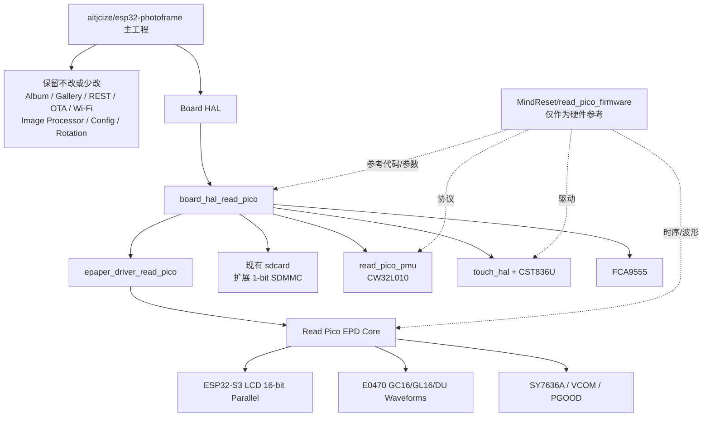
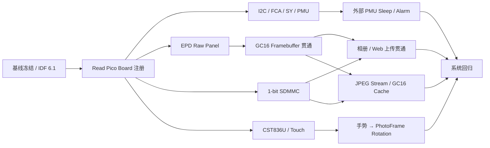
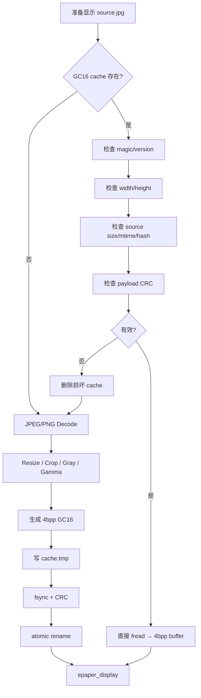

# Read Pico 基于 `esp32-photoframe` 的可执行移植实施方案

## Executive Summary

本报告明确以 **`aitjcize/esp32-photoframe` 为唯一主工程**，保留其现有 Web Gallery、相册、REST API、图片处理、OTA、Wi‑Fi、自动轮播和电源管理体系；`MindReset/read_pico_firmware` 仅作为 Read Pico 硬件 BSP、EPD 时序、波形、PMU、SDMMC 与触摸驱动的参考来源。当前主工程本身已经支持多种 ESP32-S3 板卡、GC16 灰阶屏和 SD 卡，是合理的产品固件基座。fileciteturn71file0L2-L2

移植的**最高风险不是 Web/相册，而是 EPD**：`esp32-photoframe` 现有 GC16 设备主要通过 IT8951/TCON 等控制器驱动，而 Read Pico 是 ESP32-S3 直接通过 16-bit LCD 并口产生裸屏扫描时序，同时还必须控制 SY7636A、电源轨、VCOM 和 ED047/E0470 波形；因此必须增加独立的 `epaper_driver_read_pico`，而不能简单修改现有 IT8951 驱动。fileciteturn60file0L2-L2 fileciteturn43file0L2-L2

SD 卡移植相对低风险：主工程已经有基于 ESP-IDF SDMMC Host 的 `sdcard_sdio.c`，Read Pico 只是从现有 4-bit 配置改为 **1-bit SDMMC，CLK=38、CMD=42、D0=44**；无需另造存储子系统。fileciteturn38file0L2-L2 fileciteturn21file0L2-L2

电源管理是第二个架构级差异：主工程最终调用 `esp_deep_sleep_start()`，而 Read Pico 参考固件的“深睡”实际由 CW32L010 接管，发送 `HOST_SOFT_SLEEP` 后由 PMU **拉掉 ESP32 的 EN**；因此需要给 `board_hal` 增加“外部睡眠控制器”能力，而不能仅把 PMU 调用塞进现有 `board_hal_prepare_for_sleep()`。fileciteturn68file0L2-L2 fileciteturn87file0L2-L2

**推荐目标 ESP-IDF 为 v6.1，同时在移植期保留 v6.0 编译门禁。** 原因是主工程当前 CI 使用 `release-v6.0`，而 Read Pico 参考固件明确要求 v6.1，且直接驱屏代码对 LCD/LL API 版本敏感；应先证明原版 PhotoFrame 在 v6.1 下无回归，再接入 Read Pico 硬件。fileciteturn29file0L2-L2 fileciteturn72file0L2-L2

按一名熟悉 ESP-IDF、具备示波器/逻辑分析仪条件的嵌入式工程师估算，**能完成 Web 上传→SD→GC16 显示的工程 MVP 约 110–180 人时；包含 Touch、外部 PMU 睡眠、JPEG 流式解码、缓存、完整回归和量产级异常处理约 180–290 人时。** 团队规模与可用工时未指定，该估算是工程量而非日历工期。

## 源码基线与架构边界

### 研究基线

本报告按 **2026 年 10 月 3 日**可访问的默认分支进行源码级分析。为了让工程团队后续不会因为上游变化而无法复现，建议正式开工时把以下 SHA 固化进移植分支文档和 CI：

| 仓库 | 本报告基线 | 最近提交时间 | 在项目中的角色 |
|---|---|---:|---|
| `aitjcize/esp32-photoframe` | `f5e3ec974403b31174a3c8da1cf09385453f4abb` | 2026-09-30 UTC | **主工程、产品系统、业务层、Web、OTA、Wi‑Fi、相册、图片处理、电源策略**。fileciteturn73file0L2-L2 |
| `MindReset/read_pico_firmware` | `28cde682a4468a581c278761922724f57d976418` | 2026-09-29 UTC | **仅作为 Read Pico 硬件与驱动参考**。fileciteturn74file0L2-L2 |

`esp32-photoframe` 当前已经提供 Web Gallery、拖放上传、REST API、SD/URL 轮播、深睡、伴生服务器与图片处理能力，而且支持 GC16 设备，包括 XIAO EE03、reTerminal E1003 和 4.7" M5Paper；这正是应该保留而不是重写的应用层。fileciteturn71file0L2-L2

Read Pico 参考固件则明确自述为“硬件演示固件”，硬件为 ESP32-S3、16 MB Flash、8 MB Octal PSRAM、4.7" 1216×684 16 灰阶、16-bit 并口、SY7636A、CW32L010、CST836U 和 1-bit SDMMC；其组件被拆成 `read_pico`、`read_pico_pmu`、`epdiy`、`cst836u`、`fca9555`、`sy7636a` 和 `e0470_epaper_waveform`，非常适合被作为 BSP/driver 参考，而不适合反过来承载 PhotoFrame 业务。fileciteturn72file0L2-L2

### 最终软件边界



工程原则是：**向 `esp32-photoframe` 添加一个新 Board，而不是把 PhotoFrame 功能移植到 Read Pico demo。** 主工程已经通过 `boards/boards.json`、`board_hal/Kconfig`、`board_hal/CMakeLists.txt` 和板级 driver 对不同设备做条件构建；现有 M5Paper driver 也展示了“板级电源 → EPD → SD → 休眠”的组织方式。fileciteturn10file0L2-L2 fileciteturn34file0L2-L2 fileciteturn56file0L2-L2

建议目标目录最终形成：

```text
esp32-photoframe/
├── boards/
│   └── sdkconfig.defaults.read_pico
│
├── components/
│   ├── board_hal/
│   │   ├── include/
│   │   │   └── board_read_pico.h
│   │   └── src/
│   │       └── driver_read_pico.c
│   │
│   ├── epaper_driver_read_pico/
│   │   ├── CMakeLists.txt
│   │   ├── Kconfig
│   │   ├── include/
│   │   │   └── epaper_driver_read_pico.h
│   │   └── src/
│   │       └── epaper_driver_read_pico.c
│   │
│   ├── read_pico_epd_core/
│   │   ├── board/
│   │   ├── timing/
│   │   └── waveform/
│   │
│   ├── read_pico_pmu/
│   ├── cst836u/
│   ├── fca9555/
│   ├── sy7636a/
│   │
│   └── touch_hal/
│       ├── include/touch_hal.h
│       └── src/touch_hal_read_pico.c
│
└── main/
    ├── input_manager.c
    └── ...
```

这里有一个必须在开工前确认的**许可证边界**：`esp32-photoframe` 仓库有 MIT LICENSE；Read Pico 主仓库是 Apache-2.0，但其中裁剪过的 `components/epdiy` 明确保留 **LGPL-3.0-or-later**。因此可以把 Apache-2.0 的 Read Pico BSP/PMU/CST836U 等组件按许可证要求复用，但若直接复制其 `epdiy` fork，就不能把整个结果简单声称为“纯 MIT”；建议将 EPDiy 作为独立第三方组件保留许可证和修改记录，并在发布前做一次许可证合规审查。fileciteturn63file0L2-L2 fileciteturn64file0L2-L2 fileciteturn65file0L2-L2

## 源码级对照与关键差异

### 关键目录与接口对应关系

| 领域 | `esp32-photoframe` 主工程 | Read Pico 参考源码 | 核心差异 | Read Pico 移植动作 |
|---|---|---|---|---|
| Board HAL | `components/board_hal/include/board_hal.h`；`src/driver_*.c`；`Kconfig`；`CMakeLists.txt`。接口包含 `board_hal_init()`、battery、charging、USB、RTC、shutdown、`prepare_for_sleep()` 等。fileciteturn6file0L2-L2 | `components/read_pico/read_pico_board.c/.h`，负责 I2C、FCA9555、SY7636A、LCD/EPD 引脚、触摸复位等。fileciteturn43file0L2-L2 | 主工程已有合适抽象；Read Pico 不需要再带一套应用框架。 | 新增 `driver_read_pico.c`，把 Read Pico BSP 映射到现有 `board_hal_*`。 |
| EPD 公共接口 | `components/epaper/include/epaper.h`：`epaper_init/get_width/get_height/display/clear/set_temperature/enter_deepsleep`。但 `epaper_config_t` 明显偏 SPI/TCON，包括 SPI host、CS/DC/RST/BUSY、IT8951 panel/VCOM 字段。fileciteturn8file0L2-L2 | `components/epdiy` + `epd_board_read_pico`；E0470 定义为 1216×684、16-bit、24 MHz；自定义 waveform 由上层传入。fileciteturn48file0L2-L2 | 公共 `epaper_*` API 可保留，但 backend 完全不同。 | 新增 `epaper_driver_read_pico` 实现相同 `epaper_*` 符号；不要修改 IT8951 driver。 |
| EPD 物理驱动 | IT8951 driver 通过 SPI 把 4bpp 数据送给 TCON，由 TCON 完成真正面板扫描、GC16 波形和电源控制。fileciteturn60file0L2-L2 | ESP32-S3 LCD 外设直接产生 16-bit 并口数据；D0-D15 在 GPIO4–18、45，另有 XLE/XSTL/XCL/SPV/CKV。fileciteturn43file0L2-L2 | **这是整个项目最大差异。** Read Pico 的 MCU 本身承担了 TCON 工作。 | 引入 Read Pico LCD render/timing 路径，PhotoFrame 上层只能看到 `epaper_display()`。 |
| 扫描时序与 waveform | IT8951/Spectra backend 的扫描细节隐藏在控制器中。 | `read_pico_epd_timing.h` 明确计算 PCLK、blanking、CKV 等，代码提示改变时钟必须重新解 timing；另有 E0470 GC16/GL16/DU waveform 组件。fileciteturn41file0L2-L2 fileciteturn66file0L2-L2 | Read Pico 不能只“发 framebuffer”；刷新模式、温度、VCOM 和波形是系统行为。 | 第一版照片刷新固定 `GC16` 全刷；GL16/DU 留给触摸 UI 优化。 |
| Framebuffer | `display_manager.c` 对 GC 屏采用 **4bpp packed framebuffer**，分配在 PSRAM，灰阶模式使用 16 级 scale 后调用 `epaper_display(epd_image_buffer)`。fileciteturn57file0L2-L2 | EPDiy high-level 使用 PSRAM framebuffer，并以 16 灰阶为主要模式；颜色逻辑为白 `0xF0` 到黑 `0x00`。fileciteturn66file0L2-L2 | 两边都是 4bpp/16 gray，**但不能在没测试前假设 nibble 顺序、行 stride 和黑白极性完全一致**。 | 增加一个仅存在于 EPD backend 的 framebuffer adapter；通过灰阶梯图/奇偶像素图确认后才能零拷贝。 |
| SD 卡 | `components/sdcard` 已有 SPI 与所谓 `sdio` backend；`sdcard_sdio.c` 实际调用 `SDMMC_HOST_DEFAULT` + `esp_vfs_fat_sdmmc_mount()`，当前 width=4。fileciteturn38file0L2-L2 | `read_pico_sd.c` 使用 1-bit SDMMC：CLK38/CMD42/D0=44、D1-D3 NC。fileciteturn21file0L2-L2 | 不是 SPI→SDMMC 重写，而是已有 SDMMC backend 的 **4-bit→1-bit 参数化**。ESP32-S3 SDMMC Host 原生支持 1/4/8-line，GPIO 可经 matrix 路由。citeturn3search3 | 给 `sdcard_config_t` 增加 `bus_width`，Read Pico 配 1；保持主工程 `/storage` 语义。 |
| PMU | Board HAL 预期 battery%、voltage、charging、USB、shutdown 等统一接口；主 `power_manager.c` 自己配置 ESP timer/EXT wake 并最终 `esp_deep_sleep_start()`。fileciteturn6file0L2-L2 fileciteturn68file0L2-L2 | `read_pico_pmu` 与 CW32L010 使用 I2C 协议，快照包含 battery mV、SOC permille、charge state、wake reason、RTC/alarm；`HOST_SOFT_SLEEP` 进入 PMU soft sleep。fileciteturn53file0L2-L2 fileciteturn78file0L2-L2 | **Read Pico 的深睡不是普通 ESP deep sleep。** 参考实现请求 PMU soft sleep 后等待 PMU 拉低 EN；关机也由 PMU 完成。fileciteturn87file0L2-L2 | 扩展 Board HAL“外部 sleep controller”能力；PMU alarm 接管自动轮播唤醒。 |
| Touch | 当前主工程没有通用 touchscreen 业务层；README 甚至明确指出 M5Paper 的 touchscreen 未被使用。fileciteturn71file0L2-L2 | `components/cst836u` 支持最多两点、IRQ、normal/deep sleep、reset/wake；复位也可通过 IO expander callback。fileciteturn55file0L2-L2 | Touch 属于 Read Pico 新能力，而不是替换主工程已有实现。 | 新建 `touch_hal`/`input_manager`；手势事件调用现有图片轮播业务，不让 CST836U driver 依赖 album/web。 |
| PSRAM / 内存 | 主工程默认 ESP32-S3 16MB Flash、Octal PSRAM 80 MHz、`SPIRAM_USE_MALLOC`。fileciteturn33file0L2-L2 | Read Pico 是 8 MB Octal PSRAM；参考 `sdkconfig.defaults` 启用实验性 Flash/PSRAM 120 MHz，并明确提示存在硬件/温度条件。fileciteturn32file0L2-L2 | 120 MHz 是板级优化，不是相册功能前提。 | **第一版保持主工程 80 MHz**；EPD/图片/缓存稳定后再单独测 120 MHz。 |
| JPEG 解码 | 当前 `image_processor.c` 使用 `espressif/esp_jpeg ^1.3.1`，配置给 decoder 的是完整 `jpg_data + jpg_size`，并分配 RGB 输出；处理后的输出虽然可按行流式写，但 JPEG 压缩输入/完整 RGB 解码仍有峰值内存。fileciteturn23file10L142-L150 fileciteturn23file15L220-L228 | `main/book/book_image.c` 已 vendor TJpgDec，使用 `jd_prepare()` input callback、MCU block output 和 `jd_decomp(..., scale)`，baseline JPEG 可在解码阶段缩放；当前 callback 是内存源。fileciteturn70file0L1-L2 | 主工程功能完整，但大型相机 JPEG 的 RAM 峰值值得优化。 | **先保留 esp_jpeg** 以减少首期变更；第二阶段增加 `FILE* → TJpgDec` baseline 流式 fast path，渐进 JPEG 保留 fallback。 |
| 构建系统 | 根 CMake 为标准 ESP-IDF 工程；`build.py` 从 `boards/boards.json` / board-specific sdkconfig 生成构建；当前 CI 用 `release-v6.0`。fileciteturn9file0L2-L2 fileciteturn58file0L2-L2 fileciteturn29file0L2-L2 | Read Pico CMake 要求更高版本，当前固件文档与 CI 采用 ESP-IDF v6.1，且直接指出 LCD/Flash HPM API 的版本依赖。fileciteturn31file0L2-L2 fileciteturn30file0L2-L2 | IDF 是显式集成风险。 | 产品目标定 v6.1；先跑 PhotoFrame 原版 v6.1 regression，移植期同时保留 v6.0 compile job。 |

### 显示路径为什么不能照搬 IT8951

主工程中的 IT8951 GC16 路径本质是：

```text
PhotoFrame 4bpp Framebuffer
          │
          ▼
      SPI / IT8951
          │
          ▼
       TCON RAM
          │
   TCON 自己执行 waveform
          │
          ▼
        E-Paper
```

Read Pico 则是：

```text
PhotoFrame 4bpp Framebuffer
          │
          ▼
epaper_driver_read_pico
          │
          ├── framebuffer 格式适配
          ├── temperature
          ├── GC16 waveform
          ├── VCOM
          └── power sequence
          │
          ▼
   EPDiy / LCD renderer
          │
      16-bit parallel
          │
   CKV / SPV / XCL / XLE ...
          │
          ▼
      裸 E0470 Panel
```

Read Pico 的板级代码不仅初始化 LCD，还通过 FCA9555 控制 MODE/XOE、SY_EN、SY_VCOM_EN 等信号，并通过 SY7636A 管理 VCOM 和 PGOOD；其上电顺序明确先使能屏电源，再操作输出控制。fileciteturn44file0L2-L2 fileciteturn45file0L2-L2

因此第一阶段的成功标准应该是“**PhotoFrame 的 4bpp framebuffer 能经过新 backend 稳定显示 16 灰阶测试图**”，而不是“Web Gallery 已经能跑”。

### 睡眠体系是另一个必须改抽象的地方

当前 PhotoFrame 的 `power_manager_enter_sleep()` 会完成定时器/EXT wake 配置、Wi‑Fi 停止、日志 flush、调用 `board_hal_prepare_for_sleep()`，之后仍会继续执行 LittleFS teardown、USB PHY 关闭，最终才 `esp_deep_sleep_start()`。fileciteturn68file0L2-L2

Read Pico 参考固件却在 `app_enter_host_sleep()` 中直接调用 `read_pico_pmu_report_sleep()` 或 `read_pico_pmu_power_off()`，随后进入无限等待；文件注释明确说明 soft sleep / power-off 会“drop EN”。fileciteturn87file0L2-L2

所以 **绝对不要**这样实现：

```c
void board_hal_prepare_for_sleep(void)
{
    ...
    read_pico_pmu_report_sleep(); // 错误位置
}
```

因为 PMU 可能在 PhotoFrame 主流程尚未完成最后清理时切断主控。

正确设计是拆成：

```text
prepare_for_sleep()
    │
    ├── display power off
    ├── touch low power
    ├── SD unmount
    └── peripheral cleanup
           │
           ▼
主工程最后的日志/flash/USB teardown
           │
           ▼
board_hal_enter_sleep()
           │
           └── 最后一步 HOST_SOFT_SLEEP
                       ↓
                    PMU drop EN
```

## 分阶段移植实施方案

### 依赖关系



### 工程任务清单

工时基于**单名有 ESP-IDF 经验的嵌入式工程师**；团队规模和实际可用工时未指定。EPD 裸屏调试的小时数高度依赖是否有示波器/逻辑分析仪以及硬件版本是否与参考源码一致。

| 阶段 | 任务 | 修改/新增路径 | 交付物 | 优先级 | 粗估工时 | 主要风险 |
|---|---|---|---|---|---:|---|
| 基线 | 固化两个上游 SHA；建立 `port/read-pico` 分支；原版 PhotoFrame 在 IDF 6.1 构建并跑 host/unit tests | `.github/workflows/*`、`docs/read_pico_port.md` | 可复现 baseline；v6.0/v6.1 CI matrix | P0 | 8–12h | v6.1 API 行为变化 |
| 基线 | 注册 Read Pico board | `boards/boards.json`、`boards/sdkconfig.defaults.read_pico`、`components/board_hal/Kconfig`、`CMakeLists.txt` | `./build.py --board read_pico` 可进入编译 | P0 | 4–6h | board config 与 driver 依赖不完整 |
| 板级 | 移植 Read Pico I2C bus、FCA9555、SY7636A 基础能力 | `components/board_hal/src/driver_read_pico.c`；新增/导入 `fca9555/`、`sy7636a/` | I2C census、PGOOD/VCOM/IOE 可读 | P0 | 12–20h | I2C 所有权冲突、电源时序错误 |
| PMU | 移植 `read_pico_pmu`，映射 Board HAL battery/charging/USB/shutdown | `components/read_pico_pmu/*`、`board_read_pico.h`、`driver_read_pico.c` | Web/API 能显示 battery/charge；PMU ready | P0 | 12–20h | PMU 协议版本、快照 stale |
| EPD | 移入最小化 Read Pico LCD render + board/timing + waveform 代码 | `components/read_pico_epd_core/*` | 不依赖 demo App 的 EPD core component | **P0 critical** | 24–40h | IDF LCD LL API；DMA/时序 |
| EPD | 实现 `epaper_driver_read_pico` 与 PhotoFrame `epaper_*` 契约 | `components/epaper_driver_read_pico/*` | `epaper_init/display/clear/enter_deepsleep` | **P0 critical** | framebuffer nibble/stride/方向 |
| EPD | GC16 测试图、VCOM、temperature、全刷稳定性 | 同上 + test app/tool | 白/黑/灰阶梯/棋盘/照片正确 | **P0 critical** | waveform/温度/VCOM 不匹配 |
| SD | 参数化现有 SDMMC backend 为 1/4 bit | `components/sdcard/include/sdcard.h`、`src/sdcard_sdio.c` | `/storage` 使用 CLK38/CMD42/D0=44，width=1 | P0 | 8–12h | 卡兼容性、热插拔 |
| 系统 | 验证现有 album/Web Gallery 在 `/storage` 不改业务代码即可工作 | `main/storage*` 仅必要修补 | Web 上传 JPG → SD → Gallery 列出 | P0 | 8–12h | 路径和容量假设 |
| Touch | 移入 CST836U driver + reset via FCA9555 | `components/cst836u/*`、`components/touch_hal/*` | 坐标/按下/抬起/滑动事件 | P1 | 12–20h | 坐标旋转、中断抖动 |
| Touch | 新建 `input_manager`，手势调用 PhotoFrame 业务 | `main/input_manager.c`、`main/main.c` | 左滑下一张；UI activity 重置 sleep timer | P1 | 8–12h | 不应从 driver 直接调用 album |
| 图片 | 先验证现有 `esp_jpeg` + `image_processor` 对 GC16 1216×684 的结果 | `main/image_processor.c`、测试代码 | JPG/PNG → PhotoFrame 4bpp → Read Pico GC16 | P0 | 8–12h | 内存峰值、灰阶 gamma |
| 图片 | 增加 TJpgDec `FILE*` baseline JPEG 流式路径 | 建议 `main/jpeg_stream_decoder.c/.h` | 大型 baseline JPEG 无整文件压缩缓冲 | P1 | 16–24h | progressive JPEG 不走 TJpgDec fast path |
| 缓存 | GC16 full-screen cache + thumbnail cache + 原子写/CRC | 建议 `main/image_cache.c/.h` | 第二次显示无需 JPEG decode/resize | P1 | 12–20h | cache invalidation、断电损坏 |
| 电源 | 给 `board_hal` 增加 external sleep controller / PMU alarm 抽象 | `board_hal.h`、`power_manager.c`、`driver_read_pico.c` | timer rotation → CW32 alarm → PMU soft sleep → 唤醒 | **P0 critical** | 与 ESP native deep sleep 假设冲突 |
| 集成 | Web、OTA、Wi‑Fi provisioning、REST、电池 API 全回归 | `main/*`、`webapp/*` 原则上少改 | Read Pico 对外表现与其他 PhotoFrame board 一致 | P1 | 8–12h | 硬件特例污染业务层 |
| 硬化 | 异常卡、损坏 JPEG、OOM、cache corruption、连续睡醒、OTA regression | tests/CI/logging | Release Candidate | P0 | 24–40h | 长周期问题 |

综合工程量约 **180–290 人时**。其中最容易并行的是 SD、PMU、Touch；**EPD 仍然是 critical path**。在 EPD 尚未通过 16 灰阶验收前，不建议工程师投入大量时间修改 Web UI。

### 建议的里程碑门禁

**Bring-up Gate**：

```text
./build.py --board read_pico
        ↓
ESP32-S3 boot
        ↓
I2C OK
        ↓
SY7636A / PMU OK
        ↓
EPD 白 / 黑 / 16阶灰
```

只有该门禁通过，才进入 PhotoFrame 应用联调。

**MVP Gate**：

```text
手机浏览器
   ↓
PhotoFrame Web Gallery
   ↓
上传 JPEG
   ↓
/storage
   ↓
现有 image_processor
   ↓
4bpp GC16 framebuffer
   ↓
epaper_driver_read_pico
   ↓
1216 × 684 照片正确显示
```

**Product Gate** 再加入 Touch、缓存、PMU 定时唤醒、异常恢复和 OTA。

## 关键实现设计与伪代码

以下代码是基于两个仓库真实接口设计的**目标实现示例**，不是对上游源码的逐字复制。Read Pico 的 `epd_hl_update_screen(..., MODE_GC16, temperature)`、front framebuffer、高级 full/from-white 刷新能力可以直接作为新 backend 的实现依据。fileciteturn66file0L2-L2

### `epaper_driver_read_pico` 统一接口

建议 PhotoFrame 公共层仍然保持：

```c
epaper_init(...)
epaper_get_width()
epaper_get_height()
epaper_display(...)
epaper_clear(...)
epaper_set_temperature(...)
epaper_enter_deepsleep()
```

不要让业务层知道 `EpdiyHighlevelState`。

示意实现：

```c
// components/epaper_driver_read_pico/src/epaper_driver_read_pico.c
// 伪代码：最终函数签名必须与 components/epaper/include/epaper.h 完全一致。

#include "epaper.h"
#include "epd_highlevel.h"
#include "read_pico_board.h"
#include "read_pico_waveform.h"

#define RP_WIDTH   1216
#define RP_HEIGHT   684
#define RP_FB_SIZE (((RP_WIDTH + 1) / 2) * RP_HEIGHT)

static EpdiyHighlevelState s_hl;
static uint8_t *s_epd_fb;
static bool s_ready;
static int s_temperature_c = 25;

uint16_t epaper_get_width(void)
{
    return RP_WIDTH;
}

uint16_t epaper_get_height(void)
{
    return RP_HEIGHT;
}

esp_err_t epaper_init(const epaper_config_t *cfg)
{
    (void)cfg;   // Read Pico 并不是 SPI/TCON backend

    // 1. 初始化共享 I2C / IOE / SY7636A / LCD board definition。
    ESP_RETURN_ON_ERROR(
        read_pico_epd_core_init(),
        TAG,
        "read pico epd core init failed"
    );

    // 2. waveform 必须来自 E0470/Read Pico 已验证的 GC16 表。
    const EpdWaveform *wf = read_pico_get_gc16_waveform();

    // 3. EPDiy high-level 会维护 front/back/diff framebuffer。
    s_hl = epd_hl_init(wf);
    s_epd_fb = epd_hl_get_framebuffer(&s_hl);

    if (!s_epd_fb) {
        return ESP_ERR_NO_MEM;
    }

    epd_hl_set_all_white(&s_hl);
    s_ready = true;
    return ESP_OK;
}
```

Read Pico 参考定义明确是 **1216×684、16-bit bus、24 MHz display definition**，而其 timing component 还对实际 PCLK/blanking 进行约束，因此这些值应该固化在 EPD core/BSP 中，而不是散落到 PhotoFrame `main/`。fileciteturn48file0L2-L2 fileciteturn41file0L2-L2

最关键的是 `epaper_display()`：

```c
static void copy_pf_gc16_to_epdiy(
    const uint8_t *src,
    uint8_t *dst,
    size_t bytes)
{
    /*
     * 第一个硬件版本不要直接 memcpy。
     *
     * 必须先通过测试图确认：
     * 1. 每 byte 左/右像素谁在高 nibble；
     * 2. 0x0 是黑还是白；
     * 3. 是否需要 X/Y mirror；
     * 4. stride 是否恰好为 ceil(width / 2)。
     *
     * 一旦测试证明布局一致，再替换成 memcpy(dst, src, bytes)。
     */
    for (size_t i = 0; i < bytes; ++i) {
        dst[i] = convert_nibble_if_required(src[i]);
    }
}

void epaper_display(uint8_t *image)
{
    if (!s_ready || !image) {
        return;
    }

    copy_pf_gc16_to_epdiy(image, s_epd_fb, RP_FB_SIZE);

    epd_poweron();

    // 照片第一版始终使用 GC16 全刷，避免差分状态和历史屏内容
    // 干扰图片质量。
    EpdDrawError err =
        epd_hl_update_screen_full(
            &s_hl,
            MODE_GC16,
            s_temperature_c
        );

    epd_poweroff();

    if (err != EPD_DRAW_SUCCESS) {
        ESP_LOGE(TAG, "GC16 refresh failed: 0x%x", err);
    }
}
```

参考 EPDiy high-level 明确要求在 update 前 `epd_poweron()`、完成后 `epd_poweroff()`；Read Pico fork 还提供 `epd_hl_update_screen_full()` 和 `from_white()`，很适合照片全刷和首次清屏。fileciteturn66file0L2-L2

清屏只操作 PhotoFrame buffer：

```c
void epaper_clear(uint8_t *fb, uint8_t gray4)
{
    if (!fb) {
        return;
    }

    gray4 &= 0x0F;

    // 两个像素打进同一 byte。
    const uint8_t packed = (gray4 << 4) | gray4;

    memset(fb, packed, RP_FB_SIZE);
}
```

进入低功耗只负责**屏幕本身**：

```c
void epaper_enter_deepsleep(void)
{
    if (!s_ready) {
        return;
    }

    // 确保面板 HV rail / XOE 被安全关闭。
    epd_poweroff();

    // 若 core 有 LCD DMA / peripheral deinit，放在这里。
    read_pico_epd_core_deinit();

    s_ready = false;
}
```

不要在这个函数里请求 CW32 `HOST_SOFT_SLEEP`；那属于 Board HAL 最终系统睡眠动作。

对于 1216×684，标准 packed GC16 framebuffer 大小是：

```text
ceil(1216 / 2) × 684
= 608 × 684
= 415,872 bytes
```

这个量级对 8 MB PSRAM 完全合理；主工程也已经按 GC 屏采用 4bpp PSRAM framebuffer。fileciteturn57file0L2-L2

### SDMMC 参数化与 TJpgDec 流式 JPEG

主工程当前的 `sdcard_sdio.c` 已经在调用 ESP-IDF SDMMC Host，因此不应新增第二套 SD 文件系统。fileciteturn38file0L2-L2

建议把：

```c
typedef struct {
    gpio_num_t clk;
    gpio_num_t cmd;
    gpio_num_t d0;
    gpio_num_t d1;
    gpio_num_t d2;
    gpio_num_t d3;
} sdcard_config_t;
```

扩展为：

```c
typedef struct {
    gpio_num_t clk;
    gpio_num_t cmd;
    gpio_num_t d0;
    gpio_num_t d1;
    gpio_num_t d2;
    gpio_num_t d3;

    uint8_t bus_width;   // 1 or 4
} sdcard_config_t;
```

Read Pico：

```c
static const sdcard_config_t READ_PICO_SD = {
    .clk       = GPIO_NUM_38,
    .cmd       = GPIO_NUM_42,
    .d0        = GPIO_NUM_44,
    .d1        = GPIO_NUM_NC,
    .d2        = GPIO_NUM_NC,
    .d3        = GPIO_NUM_NC,
    .bus_width = 1,
};
```

挂载 backend：

```c
sdmmc_slot_config_t slot = SDMMC_SLOT_CONFIG_DEFAULT();

slot.clk = cfg->clk;
slot.cmd = cfg->cmd;
slot.d0  = cfg->d0;
slot.width = cfg->bus_width;

if (cfg->bus_width == 4) {
    slot.d1 = cfg->d1;
    slot.d2 = cfg->d2;
    slot.d3 = cfg->d3;
}
```

ESP32-S3 的 SDMMC Host 官方支持 1-line 和 4-line SD 卡模式，因此这属于正常配置扩展，而不是 workaround。citeturn3search3

JPEG 方面，Read Pico 参考实现已经证明 TJpgDec 的输入是 callback 模型，并且在 `out == NULL` 时 callback 可以只“跳过”数据；其现有实现只是把 callback 指向一块内存。fileciteturn70file0L1-L2

因此可以直接改成 `FILE*`：

```c
typedef struct {
    FILE *fp;

    uint8_t *dst_4bpp;
    uint16_t dst_w;
    uint16_t dst_h;

    // crop / scale state
    int crop_x;
    int crop_y;

    uint32_t decoded_blocks;
} jpeg_file_ctx_t;

static size_t jpeg_file_input(
    JDEC *jd,
    uint8_t *buf,
    size_t requested)
{
    jpeg_file_ctx_t *ctx = (jpeg_file_ctx_t *)jd->device;

    if (buf != NULL) {
        // TJpgDec 真正需要数据。
        return fread(buf, 1, requested, ctx->fp);
    }

    // TJpgDec 要跳过数据，不需要读进 RAM。
    if (fseek(ctx->fp, (long)requested, SEEK_CUR) != 0) {
        return 0;
    }

    return requested;
}
```

解码：

```c
esp_err_t jpeg_stream_decode_file(
    const char *path,
    uint8_t *dst_gc16,
    uint16_t dst_w,
    uint16_t dst_h)
{
    FILE *fp = fopen(path, "rb");
    if (!fp) {
        return ESP_ERR_NOT_FOUND;
    }

    // 8 KiB decoder workspace 放 PSRAM。
    void *work = heap_caps_malloc(
        8192,
        MALLOC_CAP_SPIRAM | MALLOC_CAP_8BIT
    );

    if (!work) {
        fclose(fp);
        return ESP_ERR_NO_MEM;
    }

    jpeg_file_ctx_t ctx = {
        .fp = fp,
        .dst_4bpp = dst_gc16,
        .dst_w = dst_w,
        .dst_h = dst_h,
    };

    JDEC jd;

    JRESULT jr = jd_prepare(
        &jd,
        jpeg_file_input,
        work,
        8192,
        &ctx
    );

    if (jr != JDR_OK) {
        goto fail;
    }

    uint8_t scale = choose_tjpgd_scale(
        jd.width,
        jd.height,
        dst_w,
        dst_h
    );

    jr = jd_decomp(
        &jd,
        jpeg_block_output,
        scale
    );

    free(work);
    fclose(fp);

    return jr == JDR_OK ? ESP_OK : ESP_FAIL;

fail:
    free(work);
    fclose(fp);
    return ESP_FAIL;
}
```

MCU block callback里直接转灰阶再写 4bpp：

```c
static inline uint8_t rgb_to_gray(
    uint8_t r,
    uint8_t g,
    uint8_t b)
{
    // 与 Read Pico 参考代码相同量级的整数 luminance。
    return (uint8_t)(
        (77u * r + 150u * g + 29u * b) >> 8
    );
}

static inline void gc16_set_pixel(
    uint8_t *fb,
    int width,
    int x,
    int y,
    uint8_t gray8)
{
    uint8_t g4 = (uint8_t)((gray8 + 8) >> 4);
    if (g4 > 15) g4 = 15;

    size_t stride = (width + 1) / 2;
    uint8_t *p = &fb[y * stride + x / 2];

    if ((x & 1) == 0) {
        *p = (*p & 0x0F) | (g4 << 4);
    } else {
        *p = (*p & 0xF0) | g4;
    }
}
```

这里的 nibble 顺序仍然必须服从前述硬件验证结果。

推荐采用“双 decoder”而不是强行全面替换：

```text
JPEG file
   │
   ├── Baseline JPEG
   │      ↓
   │   TJpgDec FILE stream
   │      ↓
   │   decode-scale
   │
   └── Progressive / unsupported
          ↓
      原 esp_jpeg fallback
```

原因是主工程的 `esp_jpeg` 流程已经成熟，而 Read Pico 的 TJpgDec 实现主要优化 baseline JPEG；参考代码本身也为未能通过 TJpgDec 的小型 JPEG 保留了另一条完整解码路径。fileciteturn70file0L1-L2

### `board_hal_read_pico` PMU、电池与睡眠

Read Pico 的 PMU snapshot 已经有 `battery_mv`、`soc_permille`、`charge_state`、`wake_reason`、alarm 等数据，所以 Board HAL 不应该重新计算电量曲线。fileciteturn76file0L2-L2

伪代码：

```c
esp_err_t board_hal_init(void)
{
    ESP_RETURN_ON_ERROR(
        read_pico_i2c_bus_init(GPIO_NUM_40, GPIO_NUM_39),
        TAG,
        "I2C init"
    );

    ESP_RETURN_ON_ERROR(
        fca9555_init(...),
        TAG,
        "IO expander"
    );

    // PMU 与其它 I2C device 共用已经存在的 master bus。
    read_pico_pmu_config_t pmu_cfg = {
        .i2c_addr = PMU_I2C_ADDR,
        .scl_speed_hz = 400000,
    };

    ESP_RETURN_ON_ERROR(
        read_pico_pmu_init(read_pico_i2c_bus(), &pmu_cfg),
        TAG,
        "CW32 init"
    );

    ESP_RETURN_ON_ERROR(
        read_pico_pmu_report_ready(),
        TAG,
        "HOST_READY"
    );

    // EPD、SD、Touch 再分别初始化。
    ...
    return ESP_OK;
}

int board_hal_get_battery_percent(void)
{
    if (read_pico_pmu_poll() != ESP_OK) {
        return -1;
    }

    const pmu_snapshot_t *s = read_pico_pmu_get();

    // PMU 是 permille，Board HAL 是 percent。
    return (int)((s->soc_permille + 5) / 10);
}

int board_hal_get_battery_voltage(void)
{
    if (read_pico_pmu_poll() != ESP_OK) {
        return -1;
    }

    return read_pico_pmu_get()->battery_mv;
}

bool board_hal_is_charging(void)
{
    if (read_pico_pmu_poll() != ESP_OK) {
        return false;
    }

    return pmu_charge_state_is_charging(
        read_pico_pmu_get()->charge_state
    );
}
```

`board_hal_is_usb_connected()` 应从 PMU 协议中的实际供电/充电状态位映射，**不要仅用 ESP USB-Serial-JTAG 是否枚举**；Read Pico 的 CW32 是整机电源控制器。PMU 协议现有状态快照已经包含 charging/power 状态，适合成为唯一事实源。fileciteturn53file0L2-L2

更重要的是扩展 sleep abstraction：

```c
// board_hal.h

bool board_hal_uses_external_sleep_controller(void);

esp_err_t board_hal_schedule_wakeup_after(
    uint32_t seconds);

void board_hal_enter_deep_sleep(void)
    __attribute__((noreturn));
```

现有所有 board 的默认实现：

```c
bool board_hal_uses_external_sleep_controller(void)
{
    return false;
}
```

Read Pico：

```c
bool board_hal_uses_external_sleep_controller(void)
{
    return true;
}

esp_err_t board_hal_schedule_wakeup_after(uint32_t seconds)
{
    // 新增一个很薄的 helper：
    // 把 PhotoFrame 的相对秒数映射成 CW32 alarm protocol。
    return read_pico_pmu_alarm_set_relative(seconds);
}

void board_hal_enter_deep_sleep(void)
{
    /*
     * 注意：
     * 所有 filesystem/log/Wi-Fi/USB teardown
     * 必须已经在调用本函数之前完成。
     */

    esp_err_t err = read_pico_pmu_report_sleep();

    ESP_LOGI(TAG, "HOST_SOFT_SLEEP: %s", esp_err_to_name(err));

    // PMU 应随后切掉 EN。
    // 如果没有断电，留在这里而不能继续运行主业务。
    for (;;) {
        vTaskDelay(portMAX_DELAY);
    }
}
```

然后修改 `main/power_manager.c`：

```c
if (config_manager_get_auto_rotate()) {
    wake_seconds = get_seconds_until_next_wakeup();

    if (board_hal_uses_external_sleep_controller()) {
        board_hal_schedule_wakeup_after(wake_seconds);
    } else {
        esp_sleep_enable_timer_wakeup(
            (uint64_t)wake_seconds * 1000000ULL
        );
    }
}

...

board_hal_prepare_for_sleep();

/*
 * 完成 storage / USB PHY / log 等最后 teardown 后：
 */
if (board_hal_uses_external_sleep_controller()) {
    board_hal_enter_deep_sleep();  // no return
}

esp_deep_sleep_start();            // existing boards
```

这样不会把 `#ifdef CONFIG_BOARD_READ_PICO` 散布到电源业务代码，也不会破坏现有 board 行为。

需要特别说明：参考固件的深睡 UI 明确把 Deep Sleep 描述为**断电后短按开机**，而 light sleep 才是按键/拿起后恢复当前页面；所以首个 Read Pico PhotoFrame 版本的低功耗验收应以 **PMU 按键 + CW32 Alarm** 为深睡唤醒源，不应把“触摸屏深睡唤醒”作为 P0 假设。fileciteturn85file0L2-L2 fileciteturn87file0L2-L2

### Touch 接入方式

CST836U driver 应只输出事件：

```c
typedef enum {
    TOUCH_EVT_DOWN,
    TOUCH_EVT_MOVE,
    TOUCH_EVT_UP,
} touch_event_type_t;

typedef struct {
    touch_event_type_t type;
    uint16_t x;
    uint16_t y;
    uint8_t points;
    int64_t timestamp_ms;
} touch_event_t;
```

业务层 `input_manager` 再做 gesture：

```c
static void on_swipe_left(void)
{
    power_manager_reset_sleep_timer();

    // 直接调用 PhotoFrame 已有统一轮播入口，
    // 它本身已经知道当前 rotation mode 是 SD 还是 URL。
    trigger_image_rotation();
}
```

主工程已有 `trigger_image_rotation()`，它被 main、HTTP server 和 power manager 共用，并负责根据 configured rotation mode 执行 SD 或 URL rotation；Touch 应复用这个入口，而不是重新实现图片选择逻辑。fileciteturn79file0L8-L8 fileciteturn79file1L19-L20

当前相册系统的 SD rotation 是 `random` 或 `sequential`，没有明确的“previous image”公共接口，因此第一版建议定义：

```text
左滑 → next / rotate
右滑 → 暂不启用，或引入 history 后再实现 previous
点击 → 唤醒/保持 active
长按 → 可选，打开简易设备菜单
```

主工程 API 已明确暴露 SD rotation mode 为 `random` 或 `sequential`。fileciteturn80file0L15-L18

若产品必须提供真正“上一张”，应单独增加 `image_history`，不要让 Touch 反向扫描文件系统。

### GC16 与缩略图缓存格式

主工程已经拥有图片处理和 4bpp display buffer，因此缓存的正确位置是：

```text
JPEG/PNG 原图
      ↓
PhotoFrame image_processor
      ↓
标准 PhotoFrame GC16 4bpp
      ↓
┌───────────────┬──────────────────┐
│ display       │ cache            │
│               │                  │
▼               ▼                  │
epaper_*      .gc16 file           │
```

缓存应保存**PhotoFrame canonical 4bpp**，而不是 EPDiy 私有 front/back framebuffer。这样 EPD backend 以后即使更换，缓存层仍不依赖 EPDiy。

建议目录：

```text
/storage/
├── albums/
│   └── ...
│
└── .photoframe/
    └── cache/
        ├── 8f1a....full.gc16
        ├── 8f1a....thumb.g4
        └── ...
```

建议头：

```c
typedef struct __attribute__((packed)) {
    char     magic[4];       // "RPGC"
    uint8_t  version;        // 1
    uint8_t  format;         // GC16_PACKED_4BPP

    uint16_t width;
    uint16_t height;
    uint16_t stride;

    uint16_t pipeline_ver;   // gamma/dither/crop算法变更时增加
    uint16_t flags;          // rotation / crop mode 等

    uint32_t source_size;
    uint32_t source_mtime;
    uint32_t source_crc32;

    uint32_t payload_crc32;
    uint32_t header_crc32;
} rp_gc16_cache_header_t;
```

Full cache：

```text
width   = 1216
height  = 684
stride  = 608
payload = 415,872 bytes
```

若缩略图使用 `304×171`：

```text
stride  = 152
payload = 152 × 171
        = 25,992 bytes
```

加载流程：



Web 删除原图时同步删 cache；覆盖上传时根据 source fingerprint 自动失效。写缓存必须采用 `temp → fsync → rename`，这样 PMU 掉电不会留下被误认为有效的完整文件。

这一模式已经在另一套 ESP32-S3 相框固件中得到实践：原图留在 SD，首次显示时 decode/resize/dither，结果作为面板格式 `.bin` 缓存，此后直接加载；其缓存还会在长度错误时自动删除重建。citeturn4search1

## 第三方参考项目与优先级

这些项目只用于借鉴特定模块，**都不应替代 `aitjcize/esp32-photoframe` 成为主工程**。

| 优先级 | 项目 | 重点参考文件/模块 | 应借鉴内容 | 不应照搬的部分 |
|---|---|---|---|---|
| **P0** | [vroland/epdiy](https://github.com/vroland/epdiy) | EPD driver、high-level framebuffer、S3 LCD output、board definitions、display definitions | Read Pico fork 本身源于 EPDiy；上游仍支持 ESP32-S3、4bpp 16 灰阶和 LilyGo T5 4.7"/ED047TC1，并说明了共享 I2C bus 的现代 ESP-IDF 初始化方式。citeturn4search0 | 不要用上游通用 board definition 替换已经验证过的 Read Pico timing/VCOM/power sequence。 |
| **P0** | [Espressif ESP-IDF SDMMC Host](https://docs.espressif.com/projects/esp-idf/en/v6.0/esp32s3/api-reference/peripherals/sdmmc_host.html) | `sdmmc_host` / `esp_vfs_fat_sdmmc_mount` | 确认 ESP32-S3 1-bit SDMMC、GPIO matrix、20/40 MHz 支持；用于实现现有 backend 参数化。citeturn3search3 | 不另起一套 storage abstraction。 |
| **P1** | [will-rigby/PhotoPainter-Nginx-Home-Assistant-Device](https://github.com/will-rigby/PhotoPainter-Nginx-Home-Assistant-Device) | `esp32_photo-frame.ino`、`image_processing.ino`、SD/cache 逻辑、Web gallery | **“保存原图 → 首次显示生成面板 cache → 后续直接加载”** 的工程模式；其 progressive JPEG 也采用 PSRAM。citeturn4search1 | Arduino framework、6 色面板 driver、AXP2101 PMU 都不适合直接移植。 |
| **P1** | [fasaiph/esp32-gallery](https://github.com/fasaiph/esp32-gallery) | `main/main.c`、display/touch BSP、gallery state machine | ESP32-S3 上“album → 点击 → 全屏 → 左右 swipe → 上滑返回”的交互状态机，可用于 Read Pico Touch UX 设计。项目本身就是 ESP-IDF、触屏和 PSRAM 图片应用。citeturn4search2 | AMOLED/LVGL 动画刷新方式不能用于墨水屏。 |
| **P2** | [dariodumlijan/photo-album](https://github.com/dariodumlijan/photo-album) | `src/main.cpp`、touch/slideshow logic | 本地 SD 相册、touch navigation、slideshow 的简单 UX 参考。citeturn1search0 | Arduino/TFT/ST7796 rendering 体系不可复用。 |
| **P2** | [aitjcize/esp32-photoframe-server](https://github.com/aitjcize/esp32-photoframe-server) | image endpoint / remote photo sources | 以后需要 Immich、Google Photos、Synology 时，应优先继续使用主工程自身生态，而不是再发明云相册协议。其 server 已提供这些 source 并在服务端做面板适配图片。citeturn3search1 | 不应把 server 作为本地 SD 相册 MVP 的强依赖。 |

EPDiy 的许可证也值得再次提醒：上游 firmware 是 LGPL v3；Read Pico fork 的 `components/epdiy` 同样明确为 LGPL-3.0-or-later。citeturn4search0 fileciteturn65file0L2-L2

## 测试计划与验收标准

建议所有硬件测试都保留统一 TAG：

```text
read_pico_hal
read_pico_epd
read_pico_sd
read_pico_pmu
read_pico_touch
image_cache
jpeg_stream
```

并把硬件测试结果写进 `docs/read_pico_validation.md`，记录板号、固件 SHA、ESP-IDF SHA、VCOM、测试 SD 卡和电池状态。

### 验收矩阵

| 测试项 | 测试方法 | 验收标准 | 推荐日志/观测 |
|---|---|---|---|
| **构建** | `./build.py --board read_pico --step firmware`，CI 分别运行 IDF 6.1 与迁移期 6.0 | v6.1 为 release gate；无 undefined symbol；board-specific sdkconfig 生效 | `Board: read_pico`, `IDF: v6.1...` |
| **Flash/PSRAM** | 启动打印 chip/heap/PSRAM | 识别 16 MB Flash、8 MB PSRAM；4bpp buffer 分配成功 | `PSRAM total/free/largest` |
| **I2C 基础** | 启动逐一 probe | CST836U `0x15`、CW32 `0x2A`、SY7636A `0x62`、配置的 FCA9555 地址均在线；地址来自 Read Pico BSP。fileciteturn43file0L2-L2 | `I2C device ... OK` |
| **PMU handshake** | `read_pico_pmu_init()` + refresh | identity/status CRC 正确，状态进入 RUNNING；参考实现本身有 `HOST_READY` 和序号恢复。fileciteturn76file0L2-L2 | `PMU1`, firmware version, `pwr=RUNNING` |
| **EPD 上电** | 示波器/逻辑分析仪观察 power/clock/control | PGOOD 正常；没有 HV timeout；XOE/power 顺序与参考 BSP 一致 | `VCOM=...`, `PGOOD=1` |
| **EPD timing** | 逻辑分析仪采集 PCLK/XCL/CKV/SPV/XLE | 实际 timing 与 Read Pico reference profile 相符；不得凭“屏能亮”判定成功 | 输出实际 PCLK、line/frame timing |
| **全白/全黑** | 依次填 `0xFF`、`0x00` | 方向正确、无黑白反转、全屏无明显条带 | refresh time + EPD error |
| **16 灰阶梯图** | 16 个等宽 patch，值 0–15 | 16 阶顺序正确，无 nibble 交换 | 每 patch 编号可人工比对 |
| **Nibble/stride** | 奇像素白、偶像素黑，再反转 | 不出现每两像素交换或行错位 | 截图/照片进入测试报告 |
| **方向测试** | 四角写 TL/TR/BL/BR + 坐标网格 | 不镜像、不上下颠倒 | `mirror_x/y`, rotation log |
| **GC16 照片** | 固定标准人像、建筑、渐变三张 | 与 reference firmware 在同一板上的 GC16 表现无明显倒退 | 两套 firmware 实拍对比 |
| **连续刷新** | 100 次 GC16 图片轮换 | 无 DMA hang、watchdog reset、PGOOD fault；PSRAM free 不持续下降 | 每 10 次 heap/PSRAM snapshot |
| **SD mount** | FAT32 卡启动挂载 | `/storage` 正常，width=1，CLK38/CMD42/D0=44 | `SDMMC width=1 mounted /storage` |
| **SD 读写** | 1 MB、20 MB 顺序读写并校验 CRC | CRC 全部一致，无 timeout | throughput + CRC |
| **拔卡异常** | 空闲时拔卡；读图时拔卡 | 不崩溃；业务返回错误；重插后的策略明确 | `ESP_ERR_*`, no panic |
| **Web Gallery** | 手机连接 PhotoFrame，上传 JPEG | Web 显示成功；文件实际进入 `/storage`；Album manager 可见 | HTTP 2xx + file path |
| **Web→显示** | Gallery “show/display” 一张 JPG | 不需要 Read Pico 专用 Web 路由；最终走统一 `epaper_display()` | upload → process → GC16 的 trace ID |
| **Baseline JPEG** | 小图、12MP、24MP 相机图 | TJpgDec fast path 成功；无整 JPEG 文件 malloc；无 watchdog | input bytes、scale、peak heap |
| **Progressive JPEG** | 至少三种 progressive JPEG | 能走明确 fallback；失败时返回可读错误，不 crash | `decoder=tjpgd/esp_jpeg` |
| **损坏 JPEG** | truncation、random bit corruption | 不写有效 cache、不死循环、不 OOM | decode error + cache removed |
| **GC16 cache miss** | 删除 `.gc16` 后显示 | 生成 cache.tmp → CRC → rename → 显示 | `cache MISS / rebuilt` |
| **GC16 cache hit** | 再显示同图 | 不再执行 JPEG decoder；直接读取 415,872-byte payload | `cache HIT` |
| **缓存断电恢复** | cache 写一半时强制掉电 | 下次检测 header/CRC 错并自动重建 | `cache invalid, rebuild` |
| **Touch 坐标** | 点四角、中心、两指 | 坐标与显示 orientation 一致；IRQ 无 storm | `x/y/points/event` |
| **Touch 下一张** | 连续左滑 200 次 | 每次最多触发一次 rotation；不重复、不丢失 activity reset | gesture ID → rotation ID |
| **Touch 与 Web 并发** | Touch 切图同时浏览 Web | 无 display mutex/rotation race | no assert/deadlock |
| **Battery** | 与 PMU reference 页面/万用表比较 | voltage 合理一致；SOC 直接用 PMU permille；充电状态正确 | `mv/soc/charge` |
| **PMU 深睡** | 无 USB、请求 sleep | 所有 SD/EPD/Wi‑Fi teardown 先完成；随后 PMU `SOFT_SLEEP`，ESP EN 被关闭 | 最后一条日志为 sleep handoff |
| **按键唤醒** | 进入 PMU sleep 后短按电源键 | 正常重新启动，PMU wake reason 正确 | `wake_reason=KEY` |
| **定时轮播唤醒** | 设置 2–5 分钟测试 alarm | CW32 定时唤醒→启动→换图→再 sleep，连续至少 50 轮 | wake timestamp / drift |
| **睡眠电流** | 同一块板用电流表分别跑 reference 和移植版 | 在未给产品绝对指标前，以 reference firmware 为基线；移植版不得出现显著额外静态耗电 | µA/mA 实测写入报告 |
| **OTA** | 从版本 A OTA 到 B，再回到正常相册 | Board ID、分区、配置、SD 相册均保留；能正常显示 | OTA success + reboot |
| **长稳** | USB 模式 24h + battery wake 100 cycle | 无内存泄漏、panic、WDT、SD corruption | min free heap、largest block、reset reason |

### 屏幕 bring-up 必须使用的测试图

不能只用一张照片判断 EPD 是否正确。第一轮至少需要下面四类：

```text
A. solid
   white / black / 25% / 50% / 75%

B. grayscale ramp
   0 1 2 3 ... 15

C. nibble pattern
   0 F 0 F 0 F ...
   F 0 F 0 F 0 ...

D. geometry
   TL                  TR

          1216 × 684

   BL                  BR
```

特别是 C 类测试，可以一次发现 PhotoFrame framebuffer 与 EPDiy framebuffer 是否存在**高低 nibble 对调**；D 类测试可以发现 X mirror、Y mirror、rotation 和 stride 错误。只有这些都通过，才允许把 framebuffer adapter 优化成 `memcpy()`。

### 建议验收日志

以下是建议统一后的日志格式，不是上游现有日志逐字输出：

```text
I read_pico_hal: board=read_pico idf=6.1 flash=16MB psram=8MB
I read_pico_hal: I2C ready SCL=40 SDA=39
I read_pico_pmu: PMU1 fw=x.y.z pwr=RUNNING battery=3920mV soc=873/1000
I read_pico_sd: mount=/storage host=SDMMC width=1 clk=38 cmd=42 d0=44
I read_pico_epd: panel=E0470 1216x684 bus=16b mode=GC16
I read_pico_epd: VCOM=<factory-value>mV temp=24C PGOOD=1
I read_pico_epd: update mode=GC16 full=1 result=OK time=xxxxms

I jpeg_stream: file=/storage/.../IMG_1234.JPG
I jpeg_stream: source=6000x4000 scale=3 decoder=tjpgd
I jpeg_stream: output=1216x684 peak_internal=... peak_psram=...

I image_cache: MISS key=...
I image_cache: write 415872B crc=...
I image_cache: HIT key=...

I touch: swipe_left dx=-183 dy=11 duration=242ms
I rotation: request source=touch result=OK

I power_manager: next rotation in 3600s
I read_pico_pmu: alarm armed +3600s
I read_pico_hal: storage/display/network prepared
I read_pico_pmu: HOST_SOFT_SLEEP accepted
```

其中 PMU reference 实现本身就会记录 `HOST_READY`、`SOFT_SLEEP`、power state 与故障状态，因此这些日志具有直接的源码基础。fileciteturn78file0L2-L2

### 最终交付判定

移植完成不应以“屏幕能显示”为标准，而应满足以下完整链路：


**工程上最重要的边界决策是：相册、Web、REST、OTA、Wi‑Fi、图片源和 rotation 继续属于 `aitjcize/esp32-photoframe`；Read Pico 只通过 Board HAL、EPD backend、SDMMC、PMU 和 Touch 向上提供硬件能力。** 主工程当前本来就是为多个不同板卡通过 `board_hal` 和 board-specific driver 组织的，这个移植方式顺着其现有架构扩展，而不是另起一套产品系统。fileciteturn6file0L2-L2 fileciteturn34file0L2-L2

从实施顺序看，真正的 critical path 应固定为：

```text
IDF 6.1 baseline
      ↓
Read Pico board registration
      ↓
I2C / IOE / SY7636A
      ↓
16-bit EPD timing
      ↓
GC16 waveform
      ↓
PhotoFrame 4bpp → EPD
      ↓
1-bit SDMMC
      ↓
Web Gallery → JPEG → GC16
      ↓
Touch
      ↓
CW32 alarm / PMU sleep
      ↓
JPEG streaming + cache
      ↓
量产级异常与长期测试
```

只要 **“PhotoFrame 现有 4bpp 图像缓冲 → `epaper_driver_read_pico` → 1216×684 GC16”** 这一条链在真实硬件上跑通，剩余工作主要属于已有 PhotoFrame 系统的板级集成，而不是重新开发一个相册系统。主工程已经具备 Web Gallery、上传、SD rotation、URL image source、REST API 和完整的产品级 PhotoFrame 业务能力，因此这一方案的核心价值正是把开发成本集中在 Read Pico 独有的硬件差异上。citeturn3search0